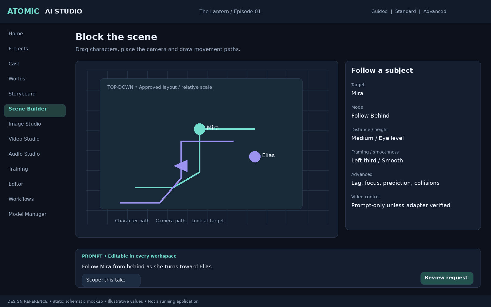
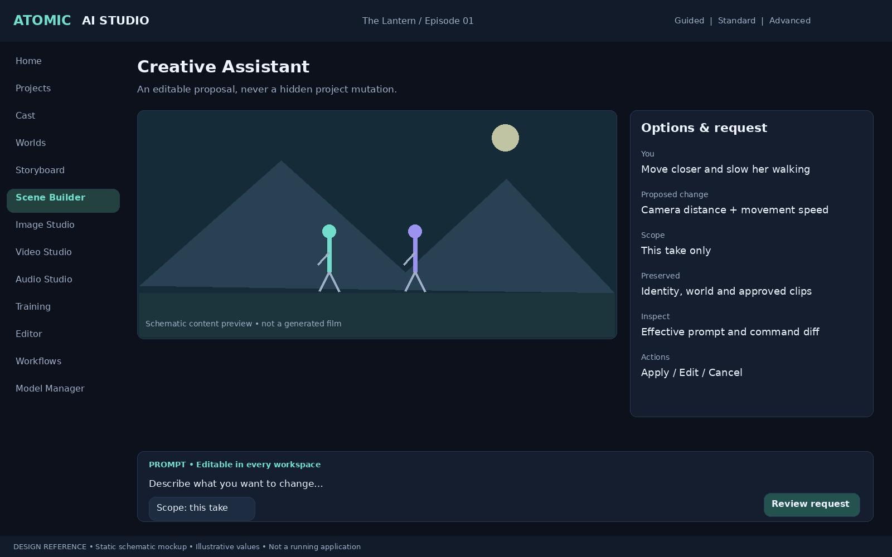
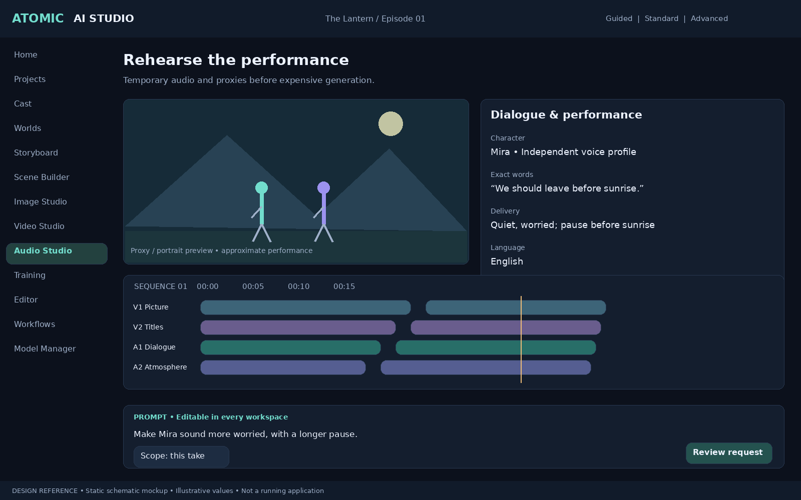
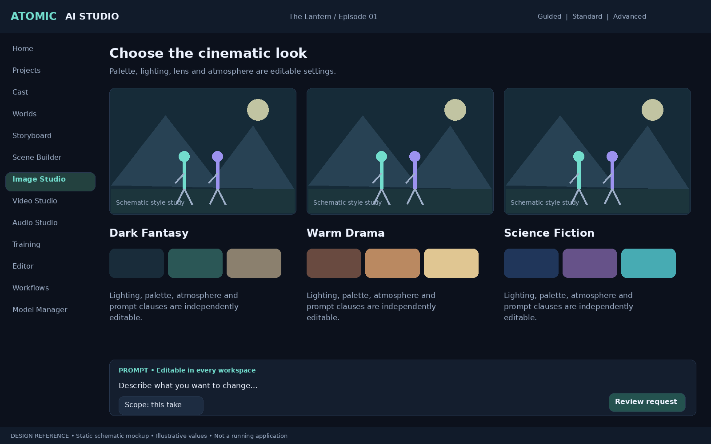

# v0.7 — Beginner-first creative production and unified commands

**Status:** mandatory design and implementation requirements, added to v0.6.1. All earlier requirements remain in force, including multi-project isolation, many characters per project, persistent cinematic world, direct editable prompts, ten camera-follow modes, and model-capability honesty.

## 0. Product principles (non-negotiable)
1. A first-time user must be able to create, review, modify, and export a short scene without knowing the words LoRA, CUDA, ComfyUI, diffusion, codec, or node graph.
2. All workflows operate on **one canonical, versioned project model**; Guided Studio, assistant chat, prompt editor, scene builder, timeline, and node editor must not maintain competing state.
3. **Prompt editing is always available.** Show the effective user-editable prompt, inherited world/character constraints, model controls, and preview of what a proposed change affects. Do not silently rewrite approved creative intent.
4. AI suggestions are proposals, not irreversible commands. Preview diffs, require confirmation for costly/destructive actions, and preserve undo/redo and provenance.
5. Every UI feature must have a useful offline/local mode where technically feasible; clearly disclose any cloud dependency and estimated cost before sending data.
6. The UI should use everyday terms by default, with contextual tooltips and an optional Advanced workspace.

## 1. Conversational Creative Assistant — P0 user experience
- Persistent, context-aware assistant across dashboard, script, character/world wizard, scene builder, editor, camera, audio, and export.
- Understand natural-language revisions: “move the camera closer”, “keep her face but change her coat”, “make this shot 4 seconds longer”, “track the two actors”, “use warmer lighting”.
- Resolve target scope explicitly: selected object/shot, current scene, or entire project. Default to **current selection / current take**; ask if ambiguous.
- Convert intent into a typed **proposed command batch**, with human-readable before/after preview, affected objects, cost/VRAM estimate, model limitations, and Approve / Edit Prompt / Cancel.
- Use project facts from the Film Memory Engine with provenance; distinguish user-approved canon from AI inferences.
- Keep the complete effective prompt editable; allow user to lock text spans or constraints against automatic changes. No paid generation or model downloads without consent.
- Support undo, redo, action history, and recoverable failure. No assistant-only private mutations.

## 2. Visual Scene Builder — P0/P1
- Drag/drop characters, props, and locations into a 2D overhead layout; optional lightweight 3D proxy scene.
- Select, move, rotate, scale, align, snap, duplicate, and group objects; keyframe actions and character paths.
- Camera gizmos, lens/framing controls, **all ten camera-follow modes** and tracking targets from `CAMERA_FOLLOW_AND_TRACKING.md`.
- Simple controls: “put her beside the door”, “follow behind at 3 m”, “look at the second actor”.
- Persist transforms in the same scene/shot schema used by prompts, assistant, and node workflow.
- Show model-control capability: exact 3D blocking in preview versus approximate generated video where model cannot enforce spatial coordinates.
- Switching visual/prompt/advanced view must not discard edits; surface conflicts for resolution.

## 3. Character and World Creation Wizards — P0
- Guided character flow: description or images -> candidates -> select identity -> face/body/wardrobe/expression -> optional voice -> reference approval -> reusable Character Bible. Many characters, no arbitrary small cap.
- Guided world flow: description or images -> visual candidates -> select location -> rooms, geography, props, time-of-day/lighting -> reference approval -> reusable World Bible.
- Both support 'Edit prompt', import references, skip optional steps, revise later, and user-approved versions; no forced LoRA training.
- Explain licensing, likeness/voice consent, and reference provenance in plain language. Keep technical training options under Advanced.

## 4. AI Acting and Dialogue Rehearsal — P1
- Low-cost rehearsal before final generation using still portraits, subtitles, temporary TTS, timing markers, and optionally simple rigged/proxy animation.
- Per-character line delivery, emotion, pacing, pauses, gaze, gesture cues, and reaction windows on a frame-based timeline.
- Playback with temp audio and shot timing; promote approved timing to final production without claiming model-perfect fidelity.
- User can directly edit dialogue and the underlying performance prompts; label previews as approximate.

## 5. Cinematic Style Designer — P1
- Beginner presets such as Dark Fantasy, Romantic Drama, Action, Family Animation, and Sci-Fi; never imply licensed film-style replication.
- Each style is a versioned **editable bundle**: palette, lighting, lens/framing preferences, mood, grade/LUT, prompt clauses, and model-specific compatible settings.
- Scope style to shot, scene, or project with previewed propagation and opt-in updates; local overrides preserve approved shots.
- Side-by-side style previews with draft cost estimate and clear model capability caveats.

## 6. Smart Scene Transitions — P2
- Recommend match cut, action cut, motivated cut, J/L audio bridge, motion match, dissolve, or fade using adjacent shot context.
- Preview timing, transition frames, audio overlap, and whether any new video must be generated.
- Non-destructive editor objects; approval before generating transitional footage; user can override with manual edit or prompt.

## 7. AI Sound Director — P1
- Inspect approved scene metadata to suggest dialogue ambience, room tone, footsteps, cloth movement, weather, vehicles, effects, and music cues.
- Generate or import **separate editable tracks** with timeline alignment, volume, fades, spatial position when supported, and licensing/provenance.
- Preview proposals; never silently replace recorded dialogue or publish unlicensed music. Respect voice consent.
- Offline-compatible fallback to imported sound libraries; model availability is feature-gated.

## 8. Intelligent Shot Length and Pacing — P1
- Analyze screenplay, dialogue duration, action, genre, emotional beats, and total runtime to propose shot durations and cut rhythms.
- Show pacing as editable timeline suggestions, not mandatory automatic edits; compare planned versus generated runtime.
- Explain constraints of model maximum clip length and plan continuations/stitching when necessary.

## 9. Beginner-friendly error recovery — P0 release blocker
- Convert technical errors (CUDA OOM, missing model, corrupt file, incompatible LoRA, insufficient disk, disconnected provider, invalid license, timeout) into plain-language explanations.
- Offer safe actionable fixes: reduce draft resolution, switch compatible model, free disk, retry checkpoint, use remote worker with consent, relink missing file.
- Preserve completed outputs, prompts, job logs, and project state. Retry only failed substeps with explicit cost estimates.
- Keep technical diagnostics behind 'Details'; provide one-click copyable support bundle that redacts secrets and personal paths by default.

## 10. Smart Hardware Profiles — P0
- Profiles: Accessible (consumer GPU), Creator (high-end single GPU), Studio (multiple GPUs or authorized remote workers).
- Onboarding probes GPU/VRAM, RAM, disk, driver/CUDA compatibility, model storage, and local runtime availability without claiming universal GPU support.
- Recommend compatible installed models, draft/preview/final settings, expected resource bands, and fallback options; do not invent performance or cost guarantees.
- User may override with warning. Re-evaluate after hardware/model changes.

## 11. Film Publishing Assistant — P2
- Guided delivery presets for archival master, common web formats, vertical shorts, trailers, teaser edits, caption/subtitle exports, stills, and audio stems.
- Validate codec, container, resolution, aspect ratio, frame rate, color space, audio loudness, subtitle readability, safe areas, missing media, and licensing flags.
- Clearly distinguish exports the app can render from direct publishing/upload integrations that require authorized API access.
- Never publish automatically; explicit review and approval.

## 12. Interactive Learning Mode — P0/P1
- First-run optional guided sample project, contextual help, short in-app tasks, glossary in everyday language, accessible keyboard navigation, readable controls, and progress persistence.
- Demonstrate a complete mini-film: write a scene, create actor/location, choose camera follow, rehearse, generate draft, revise prompt, edit, export.
- Tutorials are skippable, restartable, and do not block experienced users. Never require cloud login to learn local functionality.
- Conduct usability testing with nontechnical Windows users; track task completion, failure recovery, and comprehension (without collecting sensitive telemetry by default).

## 13. Unified Creative Command System — **P0 foundational architecture**
**One canonical mutation pathway for all user interfaces.** Do not build separate state mutation code in assistant, node graph, visual editor, and prompt panel.

### Suggested domain model
- `CreativeCommand`: command_id, project_id, actor_id, origin (assistant/prompt/visual/timeline/node/API), command_type, target_type, target_id, scope, payload_json, expected_revision, idempotency_key, created_at.
- `CommandProposal`: proposed commands, human-readable diff, affected dependency IDs, estimated compute/cost, approval policy, capability warnings, validation errors.
- `CommandTransaction`: atomic batch, before/after revision, status, audit metadata, rollback/compensation reference.
- `ProjectRevision` + `AssetRevision`: immutable identifiers, dependency manifest, approved/pending state.
- `UndoRecord`: inverse or compensating command (do not blindly reverse completed external payments or GPU jobs).
- `PromptLayer`: user prompt, scene/world/character constraints, style directives, camera directives, adapter-specific additions, provenance, precedence, locked segments.

### Command execution contract
1. Parse/receive intent from any UI.
2. Resolve project, selection, scope and current revisions.
3. Validate schema, permissions, project isolation, references, model capabilities, license/consent, and resource limits.
4. Construct a dry-run proposal with readable diff and affected approved assets.
5. Require approval for paid/cloud work, destructive changes, canon propagation, model downloads, training, and modifications to approved shots.
6. Commit through transaction boundary with optimistic concurrency control and idempotency; append audit event.
7. Notify subscribed UI panels; invalidate dependency/render caches precisely; enqueue generation only after approval.
8. Support undo/redo or safe compensation, project recovery, and replayable test fixtures.

### API outline (illustrative; implementation can vary)
- `POST /projects/{project_id}/commands/preview`
- `POST /projects/{project_id}/commands/commit`
- `POST /projects/{project_id}/commands/{id}/undo`
- `GET /projects/{project_id}/commands/history`
- `GET /projects/{project_id}/revisions/{revision_id}`
- WebSocket events: `command.proposed`, `command.committed`, `command.rejected`, `project.revision.changed`, `job.progress`.

### Cross-interface invariant
“Follow the main character from behind at 3 meters” must produce the same canonical follow-camera configuration from assistant chat, manual camera panel, prompt-to-controls parsing, and node editor (subject to explicit defaults). The effective prompt remains visible and editable in all cases.

## 14. Release acceptance tests (must be automated where possible)
1. Beginner creates a 20–30 second multi-shot film using Guided Studio without touching technical settings; exports a playable file.
2. User edits a prompt after placing characters in scene builder; only selected take changes unless scope is explicitly broadened.
3. Assistant, visual builder, camera controls and node workflow create semantically equivalent commands and canonical project state.
4. Switching UI modes and reopening project preserves prompts, positions, tracking paths, dialogue, styles and revisions.
5. Conflicting concurrent edits reject or merge explicitly; never silently overwrite approved work.
6. Failed GPU job leaves approved assets intact and shows a plain-language recovery action.
7. No cloud calls, training, paid generation or destructive project-wide changes without informed confirmation.
8. Style changes propagate only to selected scope and do not mutate previously approved shots without acceptance.
9. Audio suggestions remain individually editable and can be removed without affecting video.
10. Export validator catches deliberately invalid FPS/codec, missing media, audio/subtitle issues.
11. Multi-project tests prove no project or shared asset leakage across commands, assistant context, search, or caches.
12. Keyboard-only usability, accessible labels, cancel/back/skip, and recovery flows pass nontechnical user acceptance testing.

## 15. Delivery sequencing / avoid scope explosion
- **Foundation first:** canonical commands, revisions, prompt layering, project isolation, model capability registry, reliable jobs and error recovery.
- **First usable vertical slice:** beginner-guided single scene -> character/world wizard -> camera-follow selection -> draft generation -> editable prompt revision -> timeline -> export.
- **Next:** conversational assistant and visual scene builder backed by the same commands, rehearsal, style designer, sound director, pacing.
- **Later:** sophisticated transitions, publishing packages, advanced 3D, multi-model orchestration. Keep optional advanced capabilities behind feature flags.
- Each phase must ship runnable Windows builds, test evidence, performance/resource measurements on specified hardware, and known limitations. Do not promise complete full-length film automation as an early milestone.

## v0.9 visual design references

See [Visual Design Specification](VISUAL_DESIGN_SPEC.md). These are new schematic design proposals, not working screenshots or recovered original photo cards.

### Block the scene

Drag characters, place the camera and draw movement paths.

### Creative Assistant

An editable proposal, never a hidden project mutation.

### Rehearse the performance

Temporary audio and proxies before expensive generation.

### Choose the cinematic look

Palette, lighting, lens and atmosphere are editable settings.

