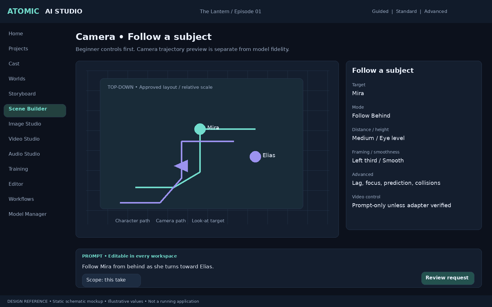

# Camera Follow / Tracking Shots — v0.6.1 amendment

Status: mandatory, high-priority feature. Extends the v0.6 handoff without removing prior requirements. Integrate into the existing camera library, movement/blocking system, performance timeline, prompt compiler and workflow engine. Do not implement a separate incompatible camera system. All ten modes are required scene-designer capabilities; generated-video fidelity depends on the verified adapter.

## 1. Beginner experience

In Guided Studio choose **Camera → Follow a subject**, then select a character, group, prop, or vehicle by name or clicking its visible marker. Show an animated schematic preview for each mode. Prompt box remains available: “Follow Mira from behind as she walks around the corner.” Resolve Mira to a stable project/branch-scoped target; ask for a selection if ambiguous.

Primary controls: target(s), mode, closer/farther distance, low/eye-level/high camera height, left/center/right framing, smoothness, start/end time and Preview. Sensible presets avoid requiring optics, rigs, coordinate systems or graph knowledge. Display meters only for an approved metric scene; otherwise show relative distance/height and explain that real-world scale is unknown. Example ranges such as 1–10 meters are adjustable presets, never universal limits. All numeric controls expose units, value, reset and keyboard operation. Provide “Change prompt,” “Try another movement,” and “Restore previous camera.”

## 2. Required follow modes and mode-specific options

| ID / Mode | Behavior | Required options |
|---|---|---|
| follow_behind / Follow Behind | Travel behind a moving subject | Distance, height, trailing lateral offset, subject-heading versus path-tangent alignment, stop behavior |
| follow_front / Follow Front | Travel backward ahead of the subject, looking toward it | Lead distance, height, look-at anchor, backward-path clearance, lead-room offset |
| follow_side / Follow Side | Travel alongside the subject | Left/right side, lateral distance, forward/backward offset, height, side-facing versus three-quarter angle |
| follow_shoulder / Follow Over Shoulder | Follow behind a selected shoulder | Left/right shoulder, shoulder anchor, camera offset, foreground shoulder visibility, framing and focus target (may be another character) |
| orbit_follow / Orbit Follow | Circle a stationary or moving target | Radius, clockwise/counterclockwise direction, start/end angle, angular speed or duration, elevation, target-relative/world orientation |
| drone_follow / Drone Follow | Elevated aerial pursuit | Height, trailing/lateral offset, tilt, ground-relative altitude when terrain exists, horizon lock, aerial clearance |
| vehicle_chase / Vehicle Chase | Follow a vehicle or moving object | Rear/front/side/three-quarter mount style, chase distance, height, speed response, turn anticipation, stabilized versus controlled vibration |
| lead_and_follow / Lead and Follow | Transition from ahead to behind, or vice versa | Start/end relationship, switch time/range, left/right transition route, easing, clearance and visibility preference |
| group_follow / Multi-Character Tracking | Keep selected characters/objects framed as a group | Member IDs, weights/primary subject, bounding-box versus centroid composition, padding, distance/zoom strategy, min/max distance and field of view, outlier policy |
| target_switch / Target Switching | Smoothly transfer tracking between targets | Ordered target IDs, event times, blend duration/easing, pan-only versus reposition, focus transition, hold time and interrupt behavior |

Modes can be combined as timed segments: for example follow_behind → orbit_follow → target_switch. Segment boundaries, targets and transition semantics are stored explicitly. Target switching is also available to every mode; group tracking can be the destination target. Vehicle chase does not require the target to be a character.

## 3. Shared and advanced camera controls

| Control | Required semantics |
|---|---|
| Target lock strength | Independently tune position-follow and look-at/orientation response; avoid a vague single gain controlling everything |
| Follow lag / damping | Separate translation and rotation damping with documented units, plus frame-rate-independent response |
| Speed matching | Match target speed with configurable response; set min/max velocity, acceleration/deceleration and angular speed; avoid jumps on stop/start |
| Look-ahead / subject prediction | Predict from approved path/velocity for a bounded time horizon; clamp unstable motion and expose prediction range |
| Framing offsets | Screen-space aim point, headroom/lead room, dead/soft zones, subject-size target and world-space anchor offset |
| Focus and optics | Look-at target distinct from focus target; lens/sensor or field of view, focus distance, depth-of-field preview, rack-focus timing and zoom limits |
| Collision avoidance | Camera-body clearance, ground clearance, occluder handling and alternate route preference using declared scene geometry; report unsatisfied constraints |
| Occlusion and lost targets | Explicit hold-last, follow-path, user-chosen switch or stop policy with timeout; never silently switch identities |
| Stabilization | Horizon/roll lock, smoothing and optional bounded handheld vibration with saved seed |
| Motion-path editing | Editable spline/control points, tangent handles, path constraints, keyframes for position/orientation/offset/distance/height, speed curve, easing and segment timing |
| Target switching | Timed target events, weighted blending, transition route and focus behavior; no teleport at a target switch |
| Coordinate controls | World/target/path-relative offsets, declared axis convention and scale; choose target facing or movement direction when they differ |
| Reuse and override | Save named versioned presets; copy/link across projects only via explicit shared-asset rules; prompt changes default to this take |

Advanced controls use progressive disclosure. No novice must configure damping or splines before generating a follow shot. All displayed controls must change persisted camera data; do not ship decorative sliders.

## 4. Coupling to subject motion and scene preview

Camera evaluates the subject's approved movement at the scene's rational timebase, including turns, speed changes and stops. Camera does not remain fixed at its initial position when a subject rounds a corner. Define target pose, facing, velocity and anchor samples separately. Use quaternions/continuous orientation interpolation and stable damping to avoid angle-wrap jumps. Orbit follows the moving center, not a fixed initial world point.

Scene designer offers synchronized top-down/side views where available, camera frustum, target labels, character paths, camera path, look-at rays, timing markers and a camera-view preview. Scrub/play/pause and edit with undo. Stable-ID binding prevents identity swaps when subjects cross or overlap. Multiple characters retain independent motion and dialogue assignments.

3D geometric collision avoidance and accurate world-space distances require approved geometry/scale. With a single uncalibrated background, provide 2D composition/path preview and mark depth, scale and collision guarantees unavailable. Estimated depth/geometry is labeled until approved. A physically impossible combination of framing, clearance and speed produces a visible conflict report, not a silently invalid path. Require user choice to relax constraints or use a cut. Reset solver state deterministically when scrubbing; preview must not depend on which frame the user previously visited.

## 5. Model adaptation and prompts

Persist three distinct layers: (1) desired creative camera intent, (2) sampled preview trajectory and scene assumptions, (3) actual provider request and supported controls. Show support per requested feature: trajectory-conditioned, reference-guided, prompt-only approximation, or unsupported. Never claim that the scene-preview camera path is enforced in the generated video.

Adapter may export a supported camera trajectory, rendered reference clip, pose/depth guidance or compiled text. Each route declares what information is lost. A pose sequence alone is not a guarantee of camera motion control. Model-specific format conversion must use explicit coordinate/timebase transforms. Check first/last-frame and duration constraints before submitting. Unsupported exact control allows an explicit approximate workflow, another compatible engine or no generation; never a hidden fallback or paid call.

Prompt Workbench exposes: “Camera follows [target] from [position], [distance/relative framing], [height], [speed], [look-at target], [start/end behavior].” User can append, edit or replace camera text. Structured camera changes inferred from text are a reviewed proposal; editing text alone does not secretly alter the path. If text conflicts with active path/reference conditioning, show the conflict and allow take-local adjustment. Both Simple and node workflows resolve to the same CameraRigVersion and compiled request. Record generated-motion evaluation separately from intended camera motion.

## 6. Persistence and API additions

Extend existing CameraPreset/CameraPath rather than duplicating them. Proposed versioned records: CameraRigVersion, CameraFollowSegment, CameraTargetBinding, CameraKeyframe, CameraTransition, CameraConstraintReport and CameraTrajectoryArtifact. Target binding includes project_id, branch_id, target entity/version, optional motion-track ID, anchor and group weights. Versioned rig stores mode segments, units/axis convention, world-version/geometry assumptions, optics/framing, damping/limits, prediction, collision/lost-target policy and source prompt revision. Frame times use integer ticks plus rational timebase. Keep UI smoothing percentage mapping to solver parameters versioned and inspectable.

Sampled trajectory artifact includes frame/tick, position, quaternion, field of view, focus target/distance, active target IDs and constraint warnings. Include content hashes and solver/adapter version. Generation snapshots and approved-shot manifests pin exact rig, motion, world, prompt and trajectory revisions. Editing camera data invalidates dependent previews/generation cache nodes without deleting or changing approved outputs.

Project-scoped service contracts: camera rigs create/revise/read, target bindings validate, trajectory solve/preview/export, constraint report, preset save/import, camera prompt compile and generation capability report. Validate target scope, missing/deleted targets, time ranges, finite numbers, positive distances, valid field-of-view limits and compatible segment transitions. All previews are local metadata/render operations unless an explicitly authorized provider preview is chosen. Events and job progress use existing project-scoped conventions.

## 7. Acceptance tests and measurable evidence

1. Cover all ten mode IDs with persisted options, UI selection, validation and reopen tests. Maintain numerical solver tests separate from real-model behavior tests.
2. With a subject moving around a right-angle corner, verify follow-behind target-relative behavior through turn/stop/restart; save per-frame position/orientation and constraint residuals.
3. Verify side left/right signs and front/behind behavior when facing direction differs from velocity; stationary targets use the configured fallback orientation.
4. Orbit a moving target, verify requested angle/radius within declared solver tolerance when constraints allow; clamp impossible speed or flag infeasibility.
5. Over-shoulder follows Character A while looking/focusing at Character B; crossing paths does not swap IDs.
6. Drone follows terrain only with declared terrain geometry; an image-only scene cannot claim terrain collision validation. Vehicle chase respects configured acceleration and saved vibration seed.
7. Lead/follow and target-switch transitions have continuous position/orientation and bounded requested velocity when feasible; infeasible cases generate warnings. Test quaternion wraparound and scrubbing in different orders.
8. Group follow frames five moving targets within requested padding when feasible, and reports inability when distance/FOV limits or occlusion prevent it. Test outlier exclusion as an explicit saved choice.
9. With known 3D obstacles, verify clearance against scene geometry; report unsolvable constraints. When a target disappears, follow the selected lost-target policy without an identity swap.
10. Sample tests at 24/1 and 30000/1001 FPS and compare common-time results to documented tolerances; save solver version, units and numerical tolerances in test fixtures. No cumulative frame drift.
11. Provider capability tests show precise preview versus approximate prompt-only behavior. Real-model runs assess follow/framing adherence as advisory evidence; do not require identical trajectories from an unconstrained model.
12. Prompt overrides remain editable; this-take changes leave the saved rig/canon unchanged. New rig versions preserve old manifests; changes invalidate the correct cached dependencies.
13. Reject cross-project target assignments without valid sharing. Restore/export/import pins camera and target-motion dependencies; missing targets produce actionable errors.
14. Novice usability task: select a named subject, choose “Follow from behind,” adjust distance/smoothness, preview and create a take without Advanced Mode. Keyboard controls and screen-reader labels cover target/mode/slider/time controls.

## 8. Delivery and priority

High priority alongside character movement and scene blocking, not optional post-release scope. Phase 0 defines camera/timebase and target-binding contracts. Phase 4 adds capability reports and camera prompt compilation. Phase 5 implements all modes, coupled motion preview, controls, keyframes and solver tests. Phase 7 integrates camera segments/trajectories into edit review; Phase 9 validates installation, recovery and portability. Specific real-model conditioning adapters are enabled only when verified. Preserve the original first-sprint boundary and all Guided Studio requirements.

## v0.9 visual design references

See [Visual Design Specification](VISUAL_DESIGN_SPEC.md). These are new schematic design proposals, not working screenshots or recovered original photo cards.

### Camera • Follow a subject

Beginner controls first. Camera trajectory preview is separate from model fidelity.

