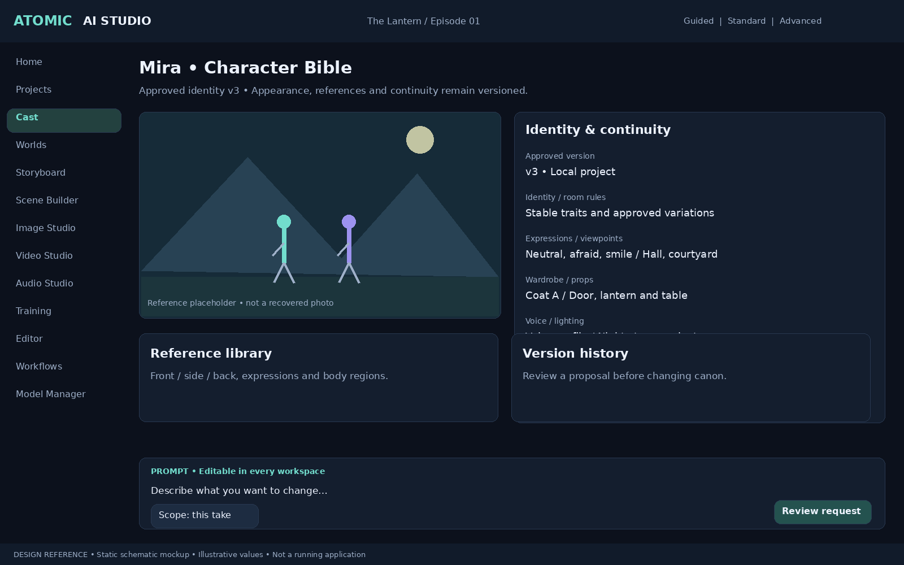
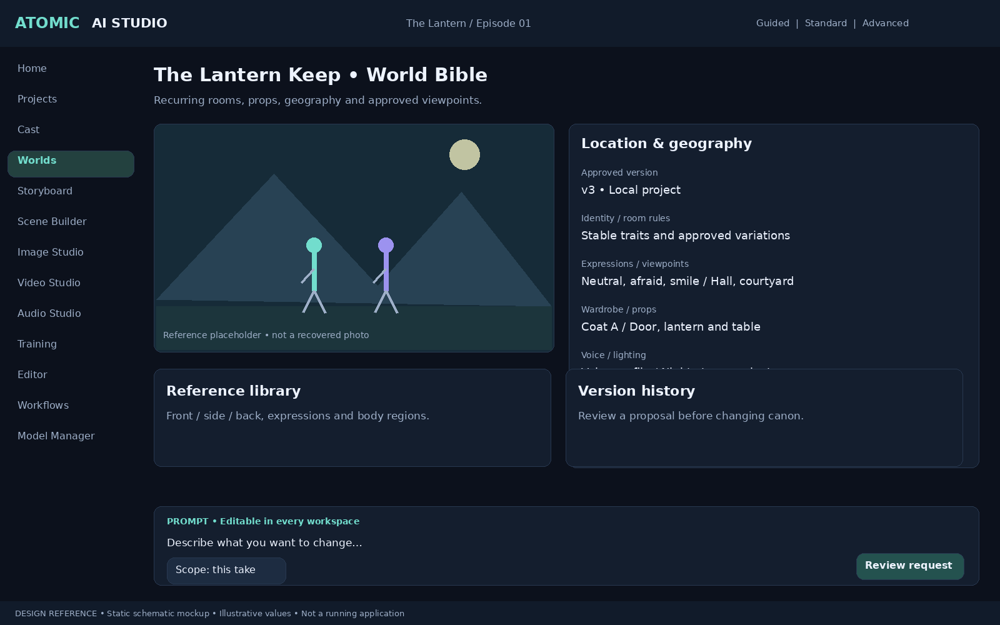
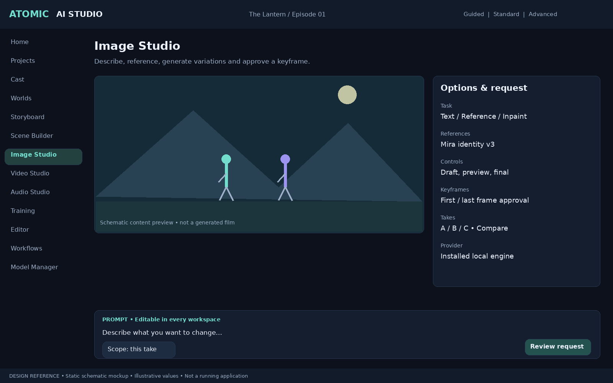
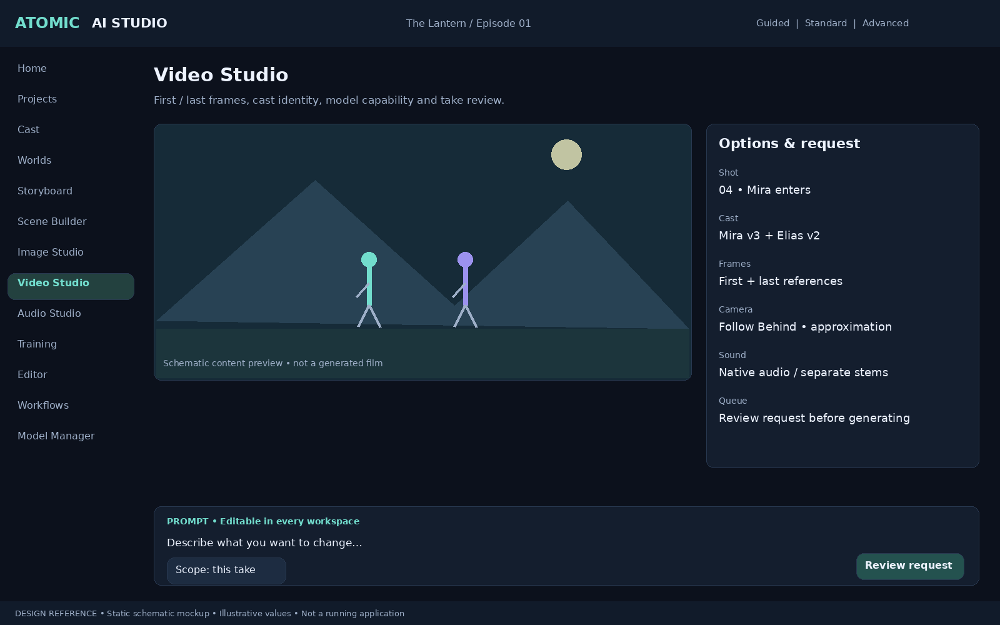
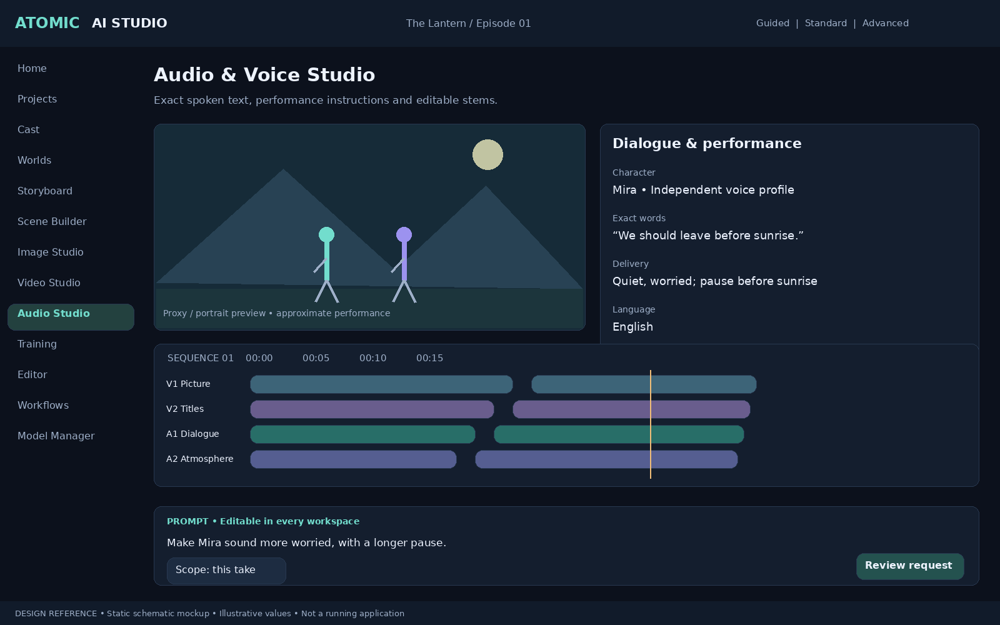
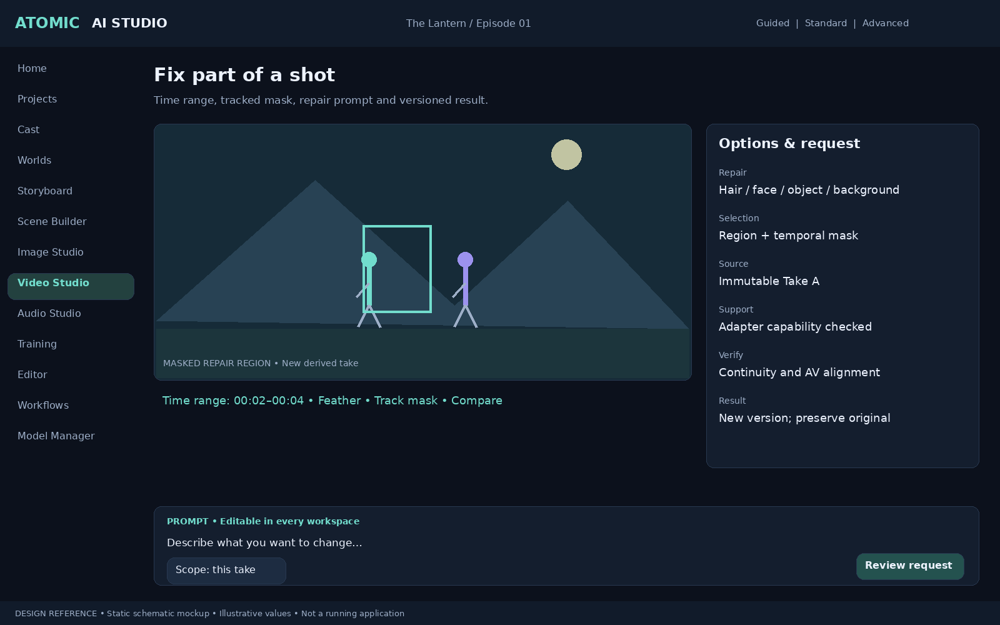
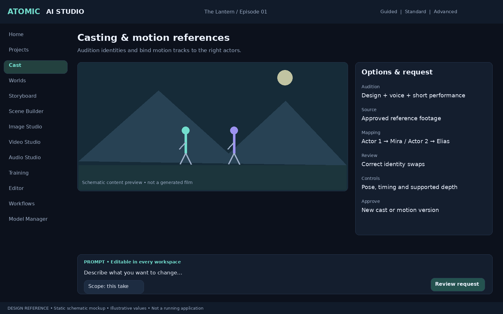

# Persistent Cinematic World + Direct Prompts — v0.5

## Authority and product decision

This amendment is accepted scope and extends DEVELOPMENT_PLAN.md and ADDITIONAL_REQUIREMENTS.md. Existing multi-project isolation, shared assets, multiple characters, standalone deployment and advanced editing remain mandatory. Where older text implies prompts are only automatically constructed, this amendment takes precedence: **structured world-based production and direct user prompt control are equally supported workflows**. They share the same asset registry, job engine, provenance and timeline.

## DUAL — Two creative workflows and hybrid editing (Critical)

1. **World-based:** choose versioned characters, locations, performances, camera and audio settings. Compile inspectable prompts and conditioning.
2. **Direct Prompt:** enter or paste a prompt for image, video, voice/audio, keyframes, repairs or a scene plan without first building a bible. Allow optional references, negative prompts where supported, seed, provider and model-specific controls. Save outputs as project assets and optionally attach them to shots later.
3. **Hybrid:** begin with a structured scene and modify any supported prompt field, or turn a direct prompt into a proposed structured scene. Conversion requires review; AI must not silently rewrite canon.

A first-class Prompt Workbench is accessible in all generation studios and contextual shot/character/location/repair inspectors. Include draft editing, templates, undo/redo, history, compare/revert, save-as-variation, resolved prompt preview and a plain-language explanation of injected references and LoRAs. Voice instructions and exact spoken dialogue are separate fields. Music, ambience and SFX prompts are distinct where supported. Unsupported negative prompts/controls are disabled with an explanation rather than sent blindly.

### Explicit change scope

Default prompt edits affect **this take only**. Other scopes are selected explicitly: shot defaults, selected shots, scene defaults, episode defaults or a proposed character/location/world-bible revision. Show affected entities and a change preview before committing broader edits. Identity edits can be experimental local variants or proposed canon revisions. They never silently modify shared assets, another character, another project, or approved outputs. Natural-language instructions such as “make her coat red” must resolve the target character or request clarification when ambiguous.

### Compilation and conflict rules

Store template/generated scaffold, user-authored text, mode (append/edit/replace), resolved references and structured versions separately. Compilation order is project → episode → scene → shot → take for prompt defaults; a selected take override wins for editable text. Resolve character bindings per character, not as one undifferentiated cast description. In replace mode the user can replace the generated text entirely, while project isolation, capability validation, budget controls and authorization still apply. Reference/LoRA/identity conditioning is visible and can be explicitly retained, removed or relaxed for an experimental take. Text changes alone do not remove conditioning.

Show conflicts between a prompt and approved constraints, including which constraint and resource are involved. User can revise the prompt, adjust take-local conditioning, or propose a bible revision. A deliberately relaxed lock marks the take as an experiment; it does not rewrite canon. Switching modes preserves drafts and never launches work. On model change, preview the new compiled request and unsupported controls before submission.

### Submission and acceptance

A user pressing Generate authorizes the displayed request within its displayed budget/policy; avoid repeated approvals for the same already authorized scope. Broader AI actions and additional spending follow the existing authorization rules. Persist exact submitted prompt fields and the full resolved conditioning for all modes, including prompt-only jobs with no shot or character association.

Acceptance:
- Generate a prompt-only image, video and voice/audio request without creating a Character Bible (using adapters or clearly separated contract tests where a real model is unavailable).
- Start from a three-character shot, change only Character B's coat for one take, and preserve other cast members and canon.
- Replace generated text, selectively disable a reference, inspect conflicts and record the resulting experiment.
- Save a shot override, preview a scene-wide change and explicitly propose/promote a bible revision; earlier approved takes remain unchanged.
- Switch modes and providers without losing drafts; ensure no hidden job or cloud request is submitted.
- Ambiguous character references require target selection before a structured change is applied.

## CON — AI Continuity Supervisor (High; Phases 2/4/5)

Extend existing identity/continuity features into one service, not a second competing checker. Compare shot output against approved identity and world versions, adjacent shots and narrative time. Track scars and handedness, wardrobe/accessories, props, room geography, time/weather, lighting direction, eyelines and screen direction. Separate user-declared facts from inferred observations. Reports cite reference frames/time ranges, confidence, severity and suggested correction. Human overrides and deliberate continuity exceptions are versioned.

Acceptance: seeded scar-side, wardrobe and prop discrepancies produce traceable findings; a deliberate exception is preserved; no findings automatically alter a bible or reject a shot.

## REPAIR — Shot Regeneration and Region Repair (High; Phases 4/5/7)

Time-range and region selection, mask painting, feathering, tracking/propagation, mask review, repair prompts and original/repaired comparison. Support temporal inpainting, face/hand correction, object/background replacement and selective relighting only with verified capable adapters. Offer a compositing/manual fallback when unsupported. Preserve source frames and audio; define whether a repair preserves duration/FPS or creates an explicit retime. New output is a derived asset version with mask assets, selected frame range, prompt and processing provenance. Do not promise perfect temporal coherence.

Acceptance: repair a bounded region/time interval with a capable backend; inspect mask drift; unchanged regions are preserved or evaluated according to the backend contract; original remains available and AV alignment is validated.

## WORLD — Persistent World and Location Bible (Critical; Phases 1/2/5)

Version world geography, locations, rooms, buildings, architecture, recurring objects, spatial relationships, weather/time/lighting variants and approved camera viewpoints. Stable location IDs and reference packs bind every shot to an explicit version. Support optional location/style LoRAs with base-model compatibility. Record canonical room connections, prop placement and units/coordinate system where known. Images alone do not establish precise 3D geometry; reconstructed layouts remain proposals until approved. Cross-project reuse follows existing copy/link/version rules.

Acceptance: reuse a castle and two connected rooms across episodes; modify a room variant without changing earlier approved shots; flag impossible door/prop continuity against declared geometry.

## PERF — AI Performance Director (High; Phases 5/6/8)

Per-character performance timeline with rational timebase: emotional intensity curves, facial expression/microexpression targets, gaze/eyeline, blink instructions, gestures, posture, motion, dialogue delivery, pauses, breathing and reactions. Interaction events reference actors and targets with synchronized times. Distinguish intended timing from actual generated performance. Store performance presets and supported pose/motion/audio conditioning; model adapters explicitly report approximate prompt guidance versus enforced controls. Expose direct prompt editing for every performance segment.

Acceptance: create two-character dialogue with staggered reactions and gaze targets; preview cues; save/reopen without time drift; report unsupported facial controls honestly.

## PASS — Multi-Pass Generation Pipeline (High; Phases 4/7, advanced after 9)

Extend the existing workflow DAG with optional layout, environment, character, motion, masks/depth, effects, composite, lighting/color-match and temporal-QC stages. Do not assume a generator returns separable render passes or physically accurate depth/alpha. Each node declares actual input/output formats, timebase, dimensions, color space, mask semantics and capability constraints. Provide a single-pass fallback. Independent character passes may lose interactions, occlusions or shared shadows: make this tradeoff visible. A changed pass invalidates dependent composites only; old approved composites remain versioned.

Acceptance: regenerate a supported background layer and recomposite against retained character assets; validate occlusion and timing; show dependency impact; unsupported pass requests fail before expensive submission.

## CAST — AI Casting Studio (High; Phases 2/3/6)

Audition design variations, voice candidates and short performances using the same evaluation scene/script. Side-by-side comparisons, tags, notes, costs and approvals. Casting variants are temporary candidate identities until explicitly promoted to a character version. Link any trained identity/voice assets only after approval.

Acceptance: compare three design and two voice candidates, select one and retain rejected candidates/provenance without altering existing characters.

## MOTION — Motion Reference Studio (High; Phases 5/6)

Import footage with provenance; extract/edit pose tracks, motion paths, timing and camera-motion hypotheses; review subject tracking, occlusions and identity binding. Map actor tracks to shot characters explicitly. Retiming and skeleton mapping are versioned transforms; no universal motion-transfer compatibility is assumed. Use supported pose/depth/reference-video conditioning or textual fallback.

Acceptance: map two tracked performers to two cast members, correct an identity swap and export a compatible conditioning sequence at the target timebase.

## CACHE — Intelligent Render Cache (High; Phases 0 contracts, 4/7/9)

Content-addressed cache keys cover exact submitted inputs, prompt compilation version, asset hashes, model/runtime revisions, precision, seeds, workflow, adapters, effects and temporal/color settings. Reuse valid existing outputs only when requested; expose “reuse” versus “new take.” A cache hit reuses bytes and is not proof that rerunning inference is deterministic. Resolve random seeds before key calculation. Outputs with unknown provider revision are eligible only under an explicit scoped cache policy. Atomic writes, corruption checks, eviction quotas, pinning and cross-project isolation are mandatory; approved assets are not evictable cache entries.

Acceptance: identical request reuses an authorized cached asset; changing a mask, LoRA, prompt or compiler version invalidates its dependent node; corrupt entries are rejected; project isolation holds.

## REPRO — Reproducible Generation Records (Critical; Phases 0/4)

Extend existing immutable snapshots with full canonical request, resolved seed(s), model/LoRA/content hashes, workflow and compiler revisions, runtime/dependency versions, driver/device information, precision, sampler/scheduler settings, remote request/job IDs and known provider revision. Record missing/undisclosed details explicitly. “Deterministic record” means exact input/environment traceability, not a promise of pixel-identical output. Separate replay with available configuration from exact byte restoration of saved assets.

Acceptance: export a complete known-input record and missing-dependency report; replay never silently substitutes a model; a cloud provider's unknown revision remains marked unknown.

## EVAL — Automated Shot Evaluation (High; Phases 4/6/7)

Extend QC with versioned evaluators for decode defects, flicker, motion, identity similarity, prompt adherence and AV/lip synchronization. Keep component scores, uncertainty, reference provenance, user ratings and overrides separate. Do not rank across incompatible evaluator versions as if scores were equivalent. No single automated score guarantees aesthetic or narrative quality.

Acceptance: report technical failures and advisory metrics on benchmark clips; preserve human approval despite an explicitly overridden advisory finding.

## RESOURCE — Hardware Resource Planner (High; Phases 3/4/9)

Extend compatibility laboratory and budgets with estimates of peak VRAM, RAM, scratch/project storage, GPU time, model loading overhead and concurrency. Use measured benchmark profiles with uncertainty and conservative headroom. Device memory is per GPU unless a tested distributed backend supports explicit sharding; memory is not automatically pooled. Offer lower resolution/precision, offload or serial execution only where verified. Reserve resources and recheck available disk space at execution.

Acceptance: reject an incompatible allocation before launch; schedule two jobs serially when concurrency exceeds capacity; report estimation range rather than guaranteed duration.

## AUDIO — Scene-Level Audio Intelligence (Medium; Phases 6/8)

Build editable cue sheets from approved performances and picture: dialogue, breath/reactions, footsteps/foley, ambience, effects and score. Track speaker, locale, world space, onset/duration, priority, stem and asset provenance. Place cues on independent tracks; support ducking, room/reverb suggestions and loudness-aware mixing. Native audio remains available alongside replacement stems; user chooses retain/replace to avoid duplicate sound. Direct audio prompts and exact spoken text remain editable.

Acceptance: build a two-character cue sheet, change one line and invalidate only dependent audio/lip-sync assets; preserve original audio and export stems.

## VFX — Visual Effects Studio (Medium; Phase 7 foundation, advanced after 9)

Nondestructive compositing with masks/mattes, depth-aware effects where available, tracking, particles, weather and atmosphere. Effects have timed parameters, keyframes, color-space declarations and source dependencies. Mark estimated depth/tracks as such and provide manual correction. Preview quality may differ from final render and must be labeled.

Acceptance: track an effect to an object, correct tracking drift, render a versioned composite and retain original source media.

## FARM — Render Farm Support (Medium; after Phase 9)

Optional coordinator for trusted registered local/LAN or explicitly configured remote workers; standalone execution remains supported. Per-worker capability checks, authenticated encrypted connections, explicit project asset sharing, licensed dependency distribution, resource limits and worker enrollment/revocation. Use leases/heartbeats, resumable hash-verified transfers, idempotent result registration and artifact verification. Distribute independent supported jobs; do not claim arbitrary single-model multi-GPU scaling. Workers receive scoped jobs and credentials, not unrestricted project databases or global API keys.

Acceptance: distribute two compatible jobs, lose one worker and safely reassign; avoid duplicate registered outputs; reject incompatible or revoked workers and cross-project access.

## DELIVERY — Final Delivery Validator (High; Phases 7/9)

Versioned delivery presets validate codec/container, dimensions, rational FPS, frame count, color metadata, audio layout/sample rate, measured loudness and true peak, subtitles/timestamps/font coverage and file integrity. Store target values and provenance in each preset; platform requirements must be verified at implementation/update time, not treated as permanent facts. Produce a report with failures/warnings and suggested fixes; never silently change the master export. Support custom presets and separate cinema, web and social deliverables.

Acceptance: intentionally noncompliant export fails selected checks; corrected rendition passes; original master remains unchanged and validator/preset version is retained.

## MAN — Immutable approved-shot production manifests (Critical; Phases 0 schema, 4/7 approval)

On approving a shot, seal a schema-versioned canonical JSON manifest containing project/episode/scene/shot/take identity, world and character versions, performance/camera versions, references/hashes, exact generation records, prompt modes/overrides, conditioning and lock relaxations, model/LoRA weights, all derived repair/pass assets, audio stems, edit/effect graph, timeline/timebase/color settings, QC/review decisions and output hashes. Missing metadata is explicit. Hash the canonical manifest; approval points to its immutable ID/digest. Store large bytes by stable content reference, not embedded blobs.

A revised approved shot creates a new manifest with parent/supersedes linkage, never an in-place change. Historical bytes needed for exact restoration are pinned according to project retention settings; copying a manifest alone cannot restore deleted media. Use manifests in dependency analysis, caching, continuity, portable exports and replay. Manifest hash provides integrity, not creator identity authentication.

Acceptance: approve a shot, change its world/character version and repair a region; prove the first manifest remains byte-identical; approve the new take with a parent link; detect a tampered referenced file during package validation.

## Data model and API extensions

All new project-owned entities retain project scoping, explicit versions and validated relationships. Proposed tables: WorldVersion, LocationVersion, SpatialRelationship, PropState, ContinuityReport/Finding/Exception, PerformanceTrack/Cue, InteractionEvent, MotionReference/Track/Binding, CastingSession/Candidate/Decision, RepairRequest/MaskTrack, PassOutput, CompositeVersion, RenderCacheEntry, ResourceEstimate/Reservation, AudioCueSheet/Cue, EffectGraphVersion, RenderWorker/Lease, DeliveryValidationReport and ApprovedShotManifest.

Prompt persistence: PromptDraft, PromptRevision, PromptOverride, PromptCompilation and ChangeProposal. Fields include project_id, media_task_type, mode, target_scope, target_entity_ids, source_versions, text_fields, negative_fields, exact_dialogue, override_strategy, conditioning_overrides, resolved_payload_hash, compiler_version, author, timestamps and optimistic concurrency version. GenerationJob may omit shot_id/character associations for prompt-only work but never project_id. Canonical request has explicit arrays for characters/references; absence is valid, never invented.

Service contracts: prompts compile/preview/revise; changes propose/commit with expected versions; worlds/locations versions; performance tracks; continuity evaluate; repairs validate/submit; pass plans validate; casting sessions; motion bind/export; cache lookup/evict; resource estimate/reserve; audio cue plans; effects preview/render; worker enroll/revoke; delivery validate; manifests seal/read/verify. Use typed project-scoped contracts, idempotency, audit events and version guards. Draft modification and preview are free of generation side effects.

## Consolidated delivery map and release gates

| Stage | Additions | Proof required |
|---|---|---|
| Phase 0 | Prompt/job contracts, manifest schema, lineage/cache/resource interfaces | Migration, schema round-trip and project isolation tests |
| Phase 1 | World/location versions and bible relationships | Stable references, version isolation and package migration |
| Phase 2 | Continuity facts, casting records, character variants | Multi-character binding and unchanged prior canon |
| Phase 3 | Image Prompt Workbench, candidate auditions, input records | Prompt-only and hybrid requests; provider capability validation |
| Phase 4 | Video prompts, manifests, cache, evaluation, repair adapter, pass DAG | One verified end-to-end supported pipeline; restart/failure recovery |
| Phase 5 | Performance timelines, motion references and spatial continuity | Frame-accurate multi-character cue and binding tests |
| Phase 6 | Voice/audio prompts, audio cues, casting and sync | Exact dialogue retained; independent stems and correct speaker |
| Phase 7 | Repair/composite UI, VFX foundation, sealed edit graph, delivery checks | Nondestructive edits, render correctness and validated export |
| Phase 8 | AI Performance Director and prompt-to-world proposals | Editable change preview, explicit commit and budget scope |
| Phase 9 | Cache/resource/offline hardening and delivery benchmark | Clean installation, migration, failure recovery and offline tests |
| After Phase 9 | Advanced multi-pass/VFX and optional render farm | Tested worker security/recovery and actual backend capabilities |

New requirements extend existing modules rather than introducing duplicate continuity/QC/budget/cache systems. Each major feature needs meaningful automated tests, migration coverage when the schema changes, failure recovery and measurable acceptance evidence. AI contract tests are separate from real-model validation. No release claim is based solely on mocked model calls. Preserve the original first-sprint boundary; complete the project/multi-character foundation before attempting the full feature set.

## v0.9 visual design references

See [Visual Design Specification](VISUAL_DESIGN_SPEC.md). These are new schematic design proposals, not working screenshots or recovered original photo cards.

### Mira • Character Bible

Approved identity v3 • Appearance, references and continuity remain versioned.

### The Lantern Keep • World Bible

Recurring rooms, props, geography and approved viewpoints.

### Image Studio

Describe, reference, generate variations and approve a keyframe.

### Video Studio

First / last frames, cast identity, model capability and take review.

### Audio & Voice Studio

Exact spoken text, performance instructions and editable stems.

### Fix part of a shot

Time range, tracked mask, repair prompt and versioned result.

### Casting & motion references

Audition identities and bind motion tracks to the right actors.

