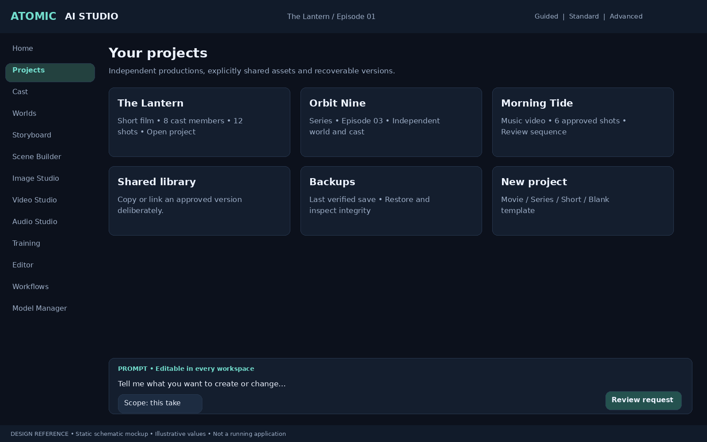
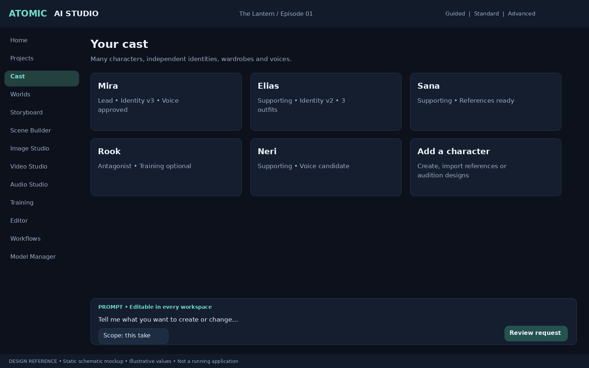
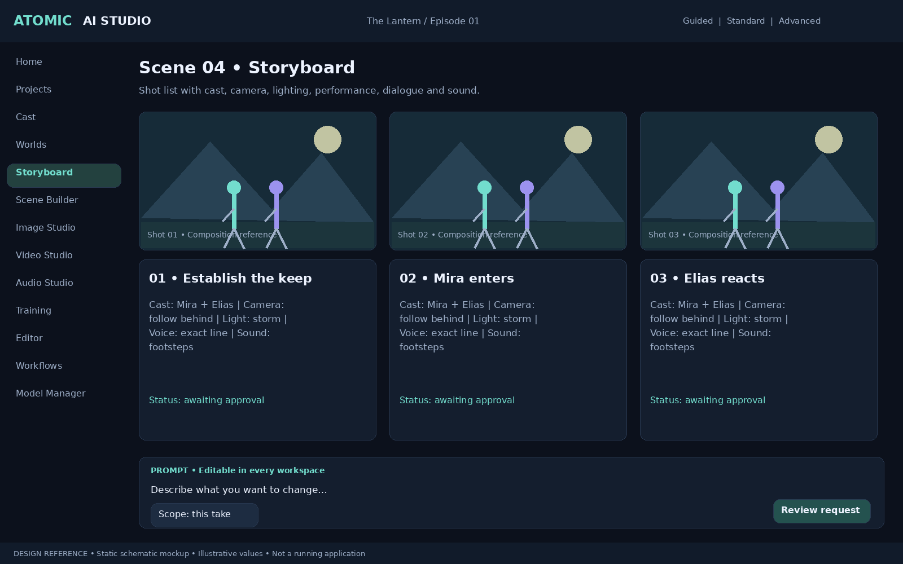
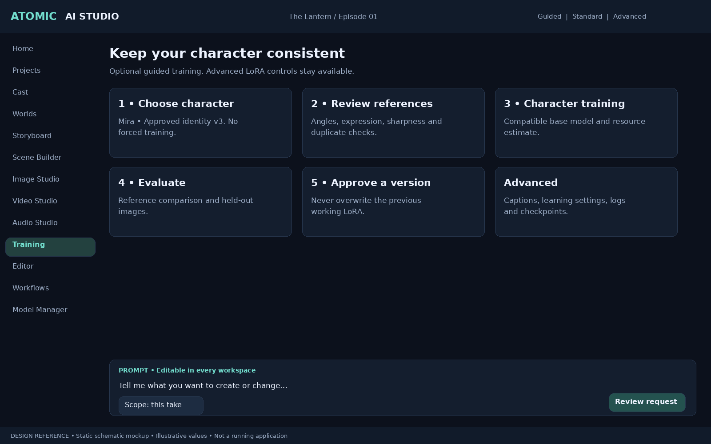
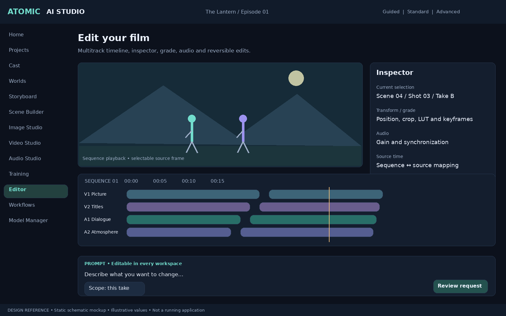

# Atomic Dream Engine — Devin Implementation Handoff
Version: 0.9  
Status: Product requirements and implementation plan  
Target: Windows standalone desktop application

## Amendment authority

Read [ADDITIONAL_REQUIREMENTS.md](ADDITIONAL_REQUIREMENTS.md) for the accepted v0.4 additions, five-system architecture, database/API additions and phased acceptance criteria. These extend the existing requirements; multi-project isolation and multi-character support remain mandatory.

## 1. Product objective

Build **Atomic Dream Engine**, a modular, Windows desktop application for planning, generating, editing, and finishing AI-assisted films. It must provide a professional workflow across project management, characters, reference analysis, image/video/audio generation, LoRA training, scene blocking, and a multitrack editor.

This document is an implementation handoff for Devin. Treat it as the source of truth for the initial implementation. Build working software incrementally; do not represent mock adapters or unimplemented features as production-ready.

## 2. Core requirement: multiple independent projects

The application must support multiple projects managed from one installation. Multi-project support is a foundational requirement, not a later enhancement.

### 2.1 Project dashboard and lifecycle
- Provide a Project Dashboard with searchable project cards/list, thumbnails, recent activity, status, storage usage, and last-opened date.
- Support create, open, rename, duplicate, archive, restore, and delete, with confirmation for destructive actions.
- Support project templates for films, animated series, short films, episodic productions, and blank projects.
- Allow switching projects without restarting the application.
- Keep project-specific settings independent: resolution, aspect ratio, frame rate, color space, visual style, preferred models, output folders, and workflow defaults.

### 2.2 Project isolation by default
- Every project-owned entity and asset must have an explicit project scope, directly or through a validated parent relationship.
- Project A must not accidentally read, modify, overwrite, or expose Project B's characters, references, prompts, LoRAs, generated outputs, timeline data, or settings.
- Enforce project scope in backend services and database queries, not only in the UI.
- Validate that foreign-key relationships do not connect unrelated projects (for example, a shot in Project A cannot be assigned a character from Project B unless the user explicitly imports/shares that character).
- Generation jobs must capture project_id and validate every referenced character, asset, LoRA, and setting against that project or an explicitly shared resource.
- Project switching must clear or reload project-scoped UI state to prevent stale selections from a previous project.

### 2.3 Optional shared asset library
Project isolation is the default, but users must have an optional Shared Asset Library for deliberate reuse across productions.

- Users can explicitly share or publish selected characters, locations, props, reference assets, approved LoRAs, and other reusable assets.
- Sharing must be an intentional user action with a clear source project, target project(s), and asset version.
- Do not silently make all assets global.
- Imported/shared assets should be represented by a project-local reference or linked snapshot with provenance to the source asset and version.
- Allow the user to choose between:
  1. **Copy into project:** creates an independent project-owned copy and version lineage.
  2. **Linked shared asset:** references a centrally managed shared asset/version; changes require explicit update/acceptance in consuming projects.
- A consuming project may create local overrides (for example, a project-specific wardrobe, character appearance variation, or continuity rule) without mutating the source asset.
- Show where a shared asset is used and warn before deleting or changing a shared source.
- If a shared asset is updated, do not silently change previously approved shots or generation records. Require an explicit update action and preserve prior snapshots.
- Support revoking sharing for future use while preserving already-imported copies and historical generation provenance.

### 2.4 Project backup, restore, and portability
- Back up and restore one project independently, including its database records, assets, references, prompts, timelines, and metadata.
- Provide project package export/import with a manifest, checksums, and version compatibility checks.
- Allow users to exclude model weights and cache/proxy files from portable packages.
- Restore must validate file integrity and avoid overwriting an existing project without explicit confirmation.
- Provide project relocation/migration to another drive while updating paths safely.
- Report missing assets, missing model dependencies, and incompatible project schema versions.

### 2.5 Project-aware storage and permissions
- Installer/setup must let users choose separate locations for application files, project files, models, cache, and backups.
- Support multiple project roots/volumes.
- Show per-project disk usage and warn when storage is low.
- Keep credentials in the secure application credential store, never in project packages.
- Project package export must redact secrets and provider credentials.

### 2.6 Multi-project acceptance tests
1. Create at least three projects with different settings and assets.
2. Switch between projects without restarting; verify all project-specific UI state refreshes correctly.
3. Create similarly named characters in two projects and prove they remain independent.
4. Attempt a cross-project character/LoRA/asset assignment without sharing; reject it with a clear error.
5. Share one character from Project A to Project B using both copy and linked modes.
6. Change the source shared asset and verify Project B is not silently modified; require explicit update acceptance.
7. Create a local override in Project B and verify Project A remains unchanged.
8. Back up, delete from the active workspace, and restore one project without affecting the others.
9. Export/import a project package and verify checksums, references, and generation history.
10. Verify generation jobs and immutable snapshots always retain the correct project scope.

## 3. Critical Phase 2 requirement: many characters per project

**The application must support many distinct characters in a project. It must never be designed around a single global character or a one-character-per-project assumption.**

### 3.1 Character library
- A project can contain many characters. Do not impose an arbitrary small limit in the data model or UI.
- Provide a searchable/filterable Character Library with grid and list views.
- Each character has a stable UUID, project association, name, aliases, description, status, tags, and version history.
- Character records are independent. Editing one character must not overwrite another character's references, voice, wardrobe, identity profile, or LoRA.
- Support duplicate/clone, archive, restore, export, import, and merge/split identity-reference groups with user confirmation.
- Support shared/global character templates only as an optional later feature; project-specific character records remain canonical.

### 3.2 Character profiles (Character Bible)
Each character has separate, versioned sections:
1. Identity: name, aliases, biography, role, personality, relationships.
2. Face: face shape, eyes, brows, nose, mouth, skin details, distinctive traits.
3. Body: height/proportions, build, posture, movement traits.
4. Hair and appearance: hair style/color, makeup, identifying details.
5. Expressions: neutral, happy, sad, angry, surprised, fear, crying, whispering, and custom expressions.
6. Wardrobe: multiple named outfits, accessories, footwear, outfit reference images, scene-specific assignment.
7. Voice: voice profile, accent, pitch, texture, pace, pronunciation, emotion presets, approved reference recordings.
8. References: multiple images and video clips, categorized and quality-scored.
9. Models: one or more LoRA/checkpoint versions, compatible base model, training dataset, evaluation results.
10. Continuity rules: details that must remain stable and allowed variations.

### 3.3 Multiple characters in scenes and shots
- A scene can include zero, one, or many characters.
- A shot can include multiple characters simultaneously.
- Use explicit many-to-many relationships: `SceneCharacter` and `ShotCharacter` (or equivalent join entities).
- Per shot-character assignment store: character_id, wardrobe_id, expression, pose/action, screen position, scale/depth, facing direction, dialogue assignment, voice profile override (optional), reference set, LoRA selection, continuity notes.
- Support character blocking: left/center/right, foreground/background, coordinates, paths, facing, timing, and interaction targets.
- Allow two or more characters to speak in the same shot, with independent dialogue and audio clips.
- The shot inspector must show every assigned character, not just a single selected character.
- Provide a cast/continuity view showing which characters appear in each scene and shot.
- Validate that character-specific settings resolve to the correct character. Never accidentally apply Character A's LoRA, voice, wardrobe, or reference images to Character B.

### 3.4 Character identity and reference intelligence
- Import batches of images/videos and analyze them for faces, people, pose, expression, clothing, and quality.
- Suggest identity clusters, but require user review before merging references into a character.
- User can correct wrong matches, split a cluster, merge clusters, and manually assign references.
- A reference image may be associated with one or more characters only where the user explicitly chooses that association (e.g. a group reference).
- Keep original files and derived crops/embeddings linked to their source and provenance.
- Do not infer that all uploaded references depict the same person.
- Support consent/provenance metadata, especially for voice cloning and training datasets.

### 3.5 LoRA training per character
- A project may have many character LoRAs.
- Each LoRA belongs to a specific character (or an explicitly declared style/concept category).
- Track base model, architecture, dataset, captions, training config, seed, training logs, checkpoint versions, evaluation images, and approval status.
- Never overwrite a previously approved checkpoint. Create a new version.
- Support training queues and GPU scheduling so multiple character training jobs can be queued without assuming all can run concurrently.
- Validate base-model compatibility before a LoRA can be selected for a generation job.

## 4. Core user workflow

1. Create/open a project.
2. Create multiple characters or import reference material in batches.
3. Review identity suggestions and build each Character Bible.
4. Prepare and train character-specific LoRAs where supported.
5. Create episodes, scenes, and shot lists.
6. Assign multiple characters to each scene and shot.
7. Set per-character wardrobe, expression, pose, position, voice, and references.
8. Build/approve keyframes and scene blocking.
9. Generate image/video/audio using local or authorized cloud providers.
10. Review, regenerate, and approve outputs.
11. Assemble and finish the project in the integrated editor.
12. Export the film and project package.

## 5. Application architecture

### Desktop and UI
- Tauri 2 desktop shell; React + TypeScript UI.
- Feature modules: Dashboard, Projects, Characters, Locations, Episodes, Storyboard, Scene Designer, Image Studio, Video Studio, Audio Studio, LoRA Workshop, Editor, Providers, Settings.
- Use a shared design system and typed API contracts.
- No direct AI-provider calls from React components.

### Backend
- Python 3.12+ with FastAPI, Pydantic, SQLAlchemy 2, SQLite, Alembic.
- REST for CRUD and job submission; WebSocket for job progress and worker events.
- UUID identifiers; foreign keys; migrations; transactional updates; backups.
- Store metadata in the database and large media/model files on disk.

### AI runtime
- Separate managed worker processes for image, video, audio, and training.
- Provider adapter interface for local and authorized cloud services.
- GPU scheduler manages VRAM, device assignment, model load/unload, priority, OOM recovery, and job persistence.
- Model capability registry must be version-aware. Never assume every model supports identical controls.
- ComfyUI may be integrated as a workflow runtime; keep provider adapters independent of the UI.

### Media
- FFmpeg/FFprobe for probing, transcoding, proxies, audio, and final rendering.
- Frame-based timeline with rational frame rates.
- Keep source assets, generated assets, proxies, and exports distinct and traceable.

## 6. Suggested technology stack

| Area | Recommended implementation |
|---|---|
| Windows desktop | Tauri 2 |
| UI | React 19, TypeScript |
| Styling/components | Tailwind CSS, Radix UI |
| State | Zustand |
| Backend API | Python 3.12+, FastAPI, Pydantic |
| Database | SQLite + FTS5, SQLAlchemy 2, Alembic |
| Media | FFmpeg, FFprobe |
| AI inference | PyTorch/CUDA, ComfyUI adapters and native adapters |
| Desktop packaging | Tauri Windows installer / NSIS |
| Tests | pytest, frontend tests, API/integration/e2e tests |

Pin dependency versions and validate actual compatibility before bundling.

## 7. Data model requirements

Minimum entities:
- Project, ProjectTemplate, ProjectPackage, ProjectBackup, SharedAsset, ProjectAssetLink, Episode, Scene, Shot
- Character, CharacterVersion, CharacterReference, CharacterExpression, CharacterWardrobe, CharacterVoiceProfile
- SceneCharacter, ShotCharacter
- Location, LocationReference, Prop
- ModelProvider, ModelInstallation, ModelCapability
- LoRAModel, LoRAVersion, TrainingDataset, TrainingJob
- Asset, AssetVersion, AssetTag
- GenerationJob, GenerationOutput, PromptVersion
- Dialogue, AudioTrack, Timeline, TimelineTrack, TimelineClip
- ProjectRevision, BackupRecord

### Required relationship rules
- Application 1-to-many Projects; each Project owns its production data and settings.
- Project 1-to-many Characters.
- Project 1-to-many Episodes.
- Episode 1-to-many Scenes.
- Scene 1-to-many Shots.
- Scene many-to-many Characters.
- Shot many-to-many Characters.
- Character 1-to-many References, Wardrobes, Expressions, and LoRA versions.
- Character may have a default voice profile; each shot-character assignment may override it.
- A shot-character assignment must reference the character-specific wardrobe, expression, LoRA, and voice configuration that applies to that shot.
- Project-owned relationships must remain within the same project unless a validated SharedAsset/ProjectAssetLink grants explicit access.
- Shared assets require source-project/source-asset/version provenance, sharing mode, target-project scope, and optional local overrides.

### Example relational shape

```text
Project
 ├── Character A ── References / Wardrobes / Voice / LoRAs
 ├── Character B ── References / Wardrobes / Voice / LoRAs
 ├── Character C ── References / Wardrobes / Voice / LoRAs
 └── Episode
      └── Scene 01
           ├── SceneCharacter: A, B, C
           ├── Shot 01 ── ShotCharacter: A, B
           └── Shot 02 ── ShotCharacter: B, C
```

Use normalized relational tables for relationships; JSON fields may hold flexible model-specific parameters but must not replace core foreign-key relationships.

## 8. Generation and continuity rules

Every generation job must persist an immutable snapshot of:
- Project, scene, shot, and assigned character IDs.
- Character Bible versions used.
- Per-character wardrobe/expression/pose/voice selections.
- Reference asset IDs and hashes.
- LoRA IDs and exact versions.
- Provider, model, model version, capability profile.
- Prompt, negative prompt, seed, and all generation parameters.
- Output asset IDs, logs, errors, and timestamps.

Character Bible edits must not retroactively alter previous generation records.

Continuity checker should flag:
- Face/identity drift.
- Hair, clothing, accessories, and body-detail mismatch.
- Wrong character voice or dialogue assignment.
- Incorrect screen position, facing, or eyeline.
- Props appearing/disappearing unexpectedly.
- Lighting and scene continuity inconsistencies.

Model-specific conditioning must be capability-gated. If a model cannot enforce a requested control, disclose the limitation and offer a supported workflow rather than pretending it can.

## 9. Devin implementation phases

### Phase 0 — Foundation
- Create monorepo, desktop shell, backend service, database, migrations, typed API client.
- Add logging, configuration, local authentication/session, health checks.
- Create CI and basic test harness.
**Acceptance:** Windows development build starts, UI connects to API, database persists after restart.

### Phase 1 — Projects and media
- Project Dashboard; project CRUD, templates, switching, archive/restore, duplicate, and independent project settings.
- Project-scoped storage, asset import, thumbnails, metadata extraction, backup/restore, and package export/import foundations.
- Episode/scene/shot hierarchy.
**Acceptance:** create multiple projects, switch without restart, import media, browse assets, create episode/scene/shot, reopen projects, and verify project isolation.

### Phase 2 — Multi-character system (critical)
- Character Library grid/list, search/filter, create/edit/archive/clone.
- Character Bible with independent versioned sections.
- Batch reference import, analysis suggestions, manual identity correction.
- SceneCharacter and ShotCharacter many-to-many relationships.
- Multi-character shot inspector and cast/continuity matrix.
- Per-character wardrobe/expression/pose/reference/LoRA/voice assignments.
- Character-specific LoRA records and version management.
- Explicitly share/copy/link a character or reusable asset across projects; track provenance and support local overrides.
**Acceptance tests:**
1. Create at least 20 distinct characters in one project and browse/search them.
2. Assign at least 8 characters to one scene.
3. Assign 5 characters to one shot and configure each independently.
4. Give two characters separate wardrobes, voices, expressions, references, and LoRAs.
5. Verify generation-job snapshots preserve the correct settings for every character.
6. Edit Character A and prove Character B is unchanged.
7. Restart the app and verify all character/scene/shot relationships persist.
8. Merge/split reference clusters with an audit trail and user confirmation.
9. Verify project A and project B isolation, including same-named characters and generation assets.
10. Share a character from project A to project B as a copy and as a linked shared asset; verify source updates require explicit acceptance and local overrides do not mutate the source.

### Phase 3 — Image generation and LoRA
- Provider/model registry, image generation workflow, reference conditioning, dataset preparation, LoRA training queue, evaluation.
**Acceptance:** generate images using a selected character profile; train and version a supported LoRA; reuse it in a later job.

### Phase 4 — Video generation
- Shot prompt builder, keyframe workflow, local video adapters, authorized cloud adapters, job queue, output review.
**Acceptance:** generate a shot, track progress, recover jobs, register output, regenerate with changed settings.

### Phase 5 — Scene Designer
- 2D blocking overlay, character position/path/timing, camera framing, optional 3D proxy preview.
**Acceptance:** position multiple characters, save blocking, and translate supported controls to a selected model workflow.

### Phase 6 — Audio
- Dialogue editor, voice profiles, TTS adapters, sound effects/music/ambience tracks, lip-sync integration.
**Acceptance:** generate dialogue for two characters in one scene with separate voice profiles and sync it to the timeline.

### Phase 7 — Advanced editor
- Multitrack timeline, trim/ripple/roll/slip/slide, transitions, titles, subtitles, transforms, keyframes, color, audio mix, proxies, render/export.
**Acceptance:** assemble and export a complete short sequence without leaving the application.

### Phase 8 — AI assistants and cloud providers
- Project-aware assistant with typed tools, plan review, provider manager, secure credential storage, cost estimates and explicit approval.
**Acceptance:** assistant proposes a multi-character scene/shot plan; user approves before any paid generation begins.

### Phase 9 — Installer, hardening, release
- Windows installer, model manager, hardware validation, backups, recovery, diagnostics, licensing/provenance screens.
**Acceptance:** clean Windows installation completes the benchmark workflow.

## 10. UI guidance for Phase 2

### Character Library
- Project-level page with cards showing portrait, name, role, status, tags, and available LoRA indicator.
- Search by name/alias; filter by role, tags, status, voice, LoRA availability.
- Multi-select for batch tagging/export/archive; never batch-edit identity fields accidentally.
- “New Character”, “Import References”, and “Analyze Batch” actions.

### Character workspace
- Left navigation: Overview, Identity, Face & Body, Expressions, Wardrobe, References, Voice, LoRAs, Continuity, History.
- Main area: editable structured profile and reference gallery.
- Right panel: validation warnings and version history.

### Shot inspector
- A visible cast list of all characters in the shot.
- Each character expands into independent controls.
- Add/remove character actions.
- Prevent ambiguous controls that could apply to all characters without an explicit “apply to selected/all” choice.
- Show conflict warnings when two characters share an incompatible or ambiguous resource assignment.

## 11. Security, licensing, and responsible use
- Store API credentials using Windows Credential Manager/DPAPI; never plaintext in project files.
- Local API should bind to loopback and use session tokens.
- Validate imported files and protect against archive path traversal.
- Verify model checksums and display licenses/terms before download or use.
- Cloud calls require explicit user consent and cost visibility.
- Voice cloning requires documented permission/consent and provenance.
- Respect model, dataset, and provider licenses. Check terms per exact model version.

## 12. Engineering rules for Devin
1. Start by inspecting the repository; do not overwrite existing work blindly.
2. Implement one milestone at a time and keep the app runnable.
3. Add migrations for schema changes; never rely on manual database edits.
4. Use UUIDs and explicit foreign keys for core entities.
5. Do not implement single-character assumptions in schemas, API payloads, UI state, prompts, or generation snapshots.
6. Do not hardcode model paths, API keys, or machine-specific directories.
7. Every background generation/training task must be persistent and observable.
8. Add tests for each acceptance criterion, especially multi-character isolation.
9. Clearly label stubs and unsupported integrations.
10. Update README, architecture docs, changelog, and setup instructions with each milestone.

## 13. First Devin task

**Implement Phase 0 and the database/API foundations for multi-project management and Phase 2.** Before building feature screens, define and test project scoping, project lifecycle, shared-asset provenance, and the multi-character relational schema. Then implement the Project Dashboard and a functional Character Library vertical slice.

Deliver:
- Source code and migrations.
- API schemas and endpoints.
- A working Windows desktop development build.
- Tests proving multiple independent projects, strict project isolation, explicit shared-asset workflows, and many characters per project/scene/shot.
- Developer setup instructions.
- A short implementation report listing completed work, limitations, and next tasks.

Do not attempt to implement every AI model adapter or the full video editor in the first milestone.

## v0.5 mandatory amendment
Read [CINEMATIC_WORLD_AND_PROMPTS.md](CINEMATIC_WORLD_AND_PROMPTS.md). This adds all sixteen latest production capabilities and establishes world-based, direct prompt and hybrid workflows with take-local edits by default, explicit broader changes, immutable approved-shot manifests, phased delivery and acceptance tests. All existing requirements and visuals are retained.

## v0.6 mandatory amendment
Read [WORKFLOWS_MEMORY_AND_USABILITY.md](WORKFLOWS_MEMORY_AND_USABILITY.md). Adds the ten accepted workflow/film-memory suggestions, beginner-first operation, consolidated phases, API/schema additions and usability acceptance gates. Direct prompt, world-based and hybrid modes remain mandatory.

## v0.6.1 camera amendment
Read [CAMERA_FOLLOW_AND_TRACKING.md](CAMERA_FOLLOW_AND_TRACKING.md): all ten required camera-follow modes, beginner and advanced controls, coupled target movement, provider capability mapping, schema/API additions and acceptance tests. This extends v0.6; all earlier requirements remain in force.


## v0.7 mandatory implementation addendum
See `BEGINNER_CREATIVE_STUDIO_AND_COMMANDS.md` for beginner-first requirements, canonical command architecture, phased milestones, and release-blocking acceptance tests. Its cross-interface consistency rules take precedence over conflicting UI implementation shortcuts.

## v0.8 mandatory amendment
Read [PRODUCTION_COMPLETION_AND_RELEASE_SCOPE.md](PRODUCTION_COMPLETION_AND_RELEASE_SCOPE.md). Adds ten accepted completion/reliability features, prioritizes backup/recovery, smart rendering and production management, defines the four-action beginner home and separates Version 1.0 essentials from later accepted scope. Existing requirements and visuals remain.

## v0.9 visual design references

See [Visual Design Specification](VISUAL_DESIGN_SPEC.md). These are new schematic design proposals, not working screenshots or recovered original photo cards.

### Your projects

Independent productions, explicitly shared assets and recoverable versions.



### Your cast

Many characters, independent identities, wardrobes and voices.



### Scene 04 • Storyboard

Shot list with cast, camera, lighting, performance, dialogue and sound.



### Keep your character consistent

Optional guided training. Advanced LoRA controls stay available.



### Edit your film

Multitrack timeline, inspector, grade, audio and reversible edits.




## v0.9 branding and visual authority
Product name is **Atomic Dream Engine**. Read [Visual Audit and Rebrand](VISUAL_AUDIT_AND_REBRAND.md) and [Visual Design Specification](VISUAL_DESIGN_SPEC.md). Use the bundled original design boards as layout proposals with the preceding functional requirements.
