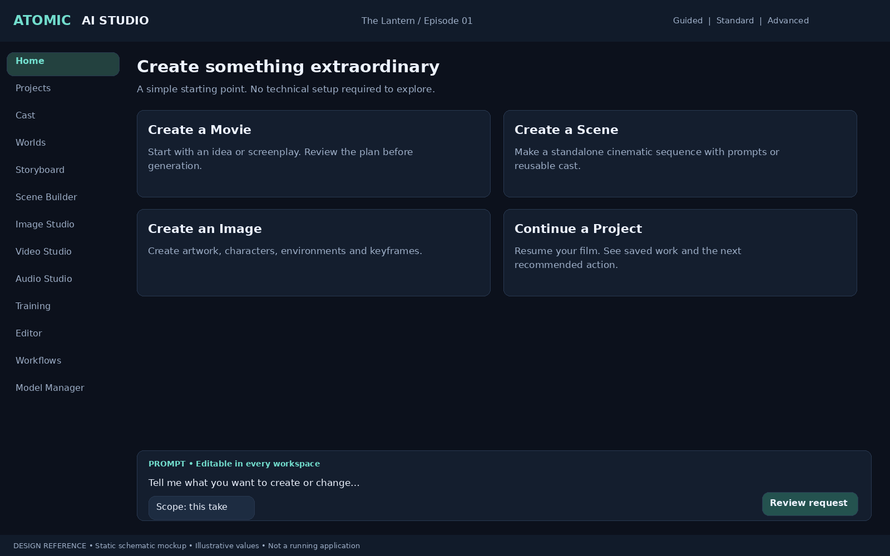
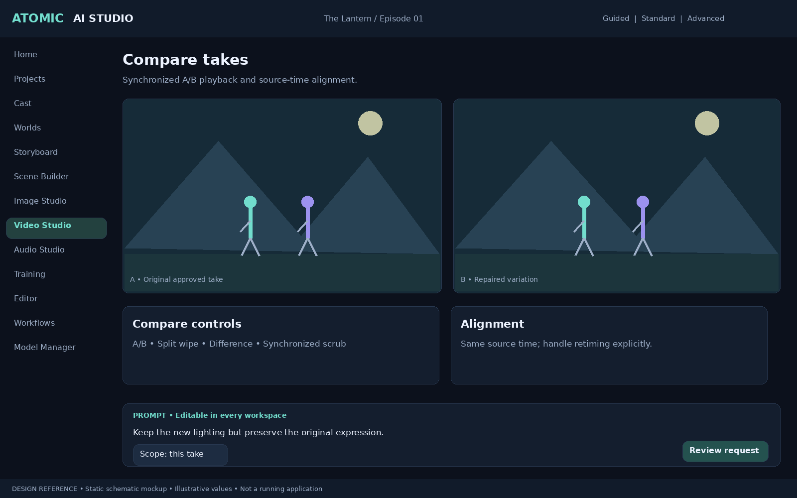
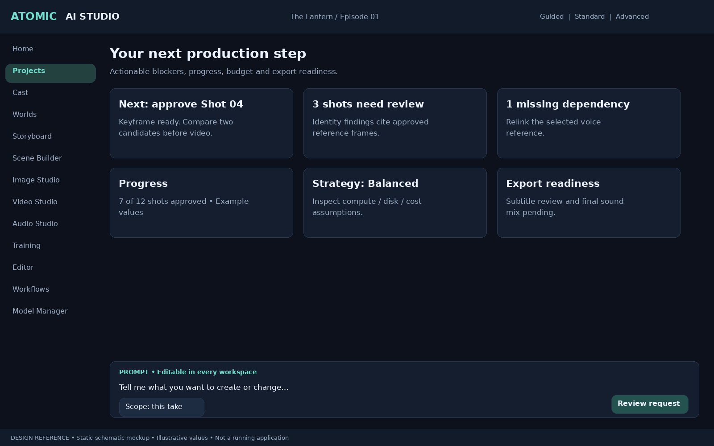
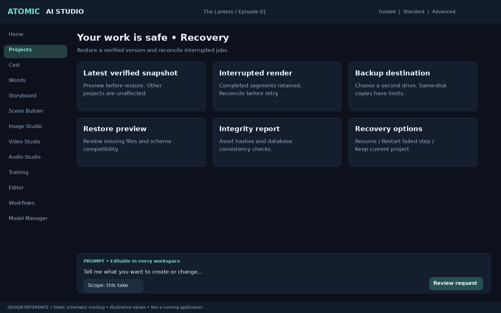
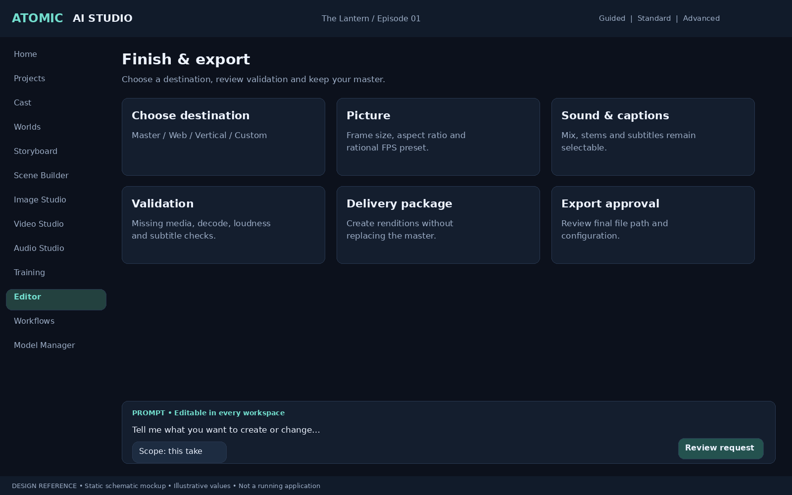
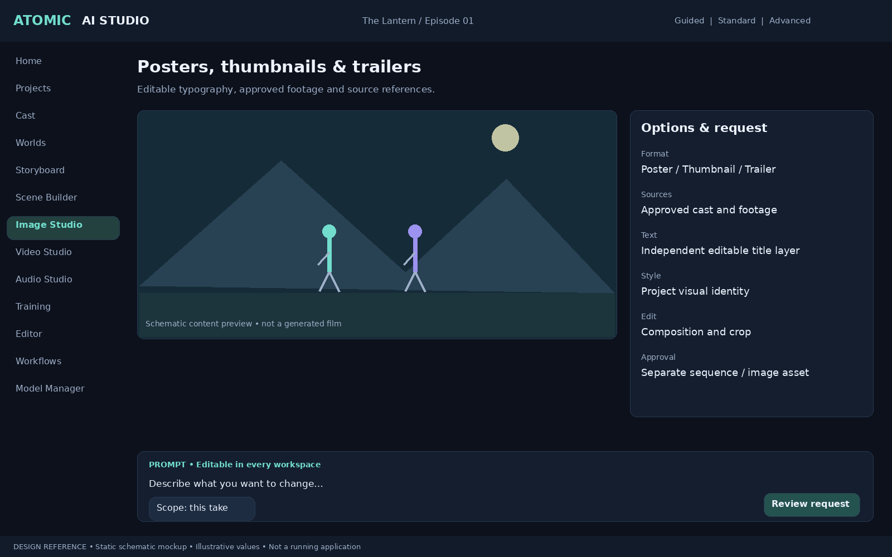
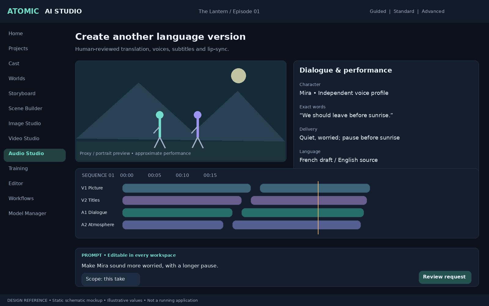
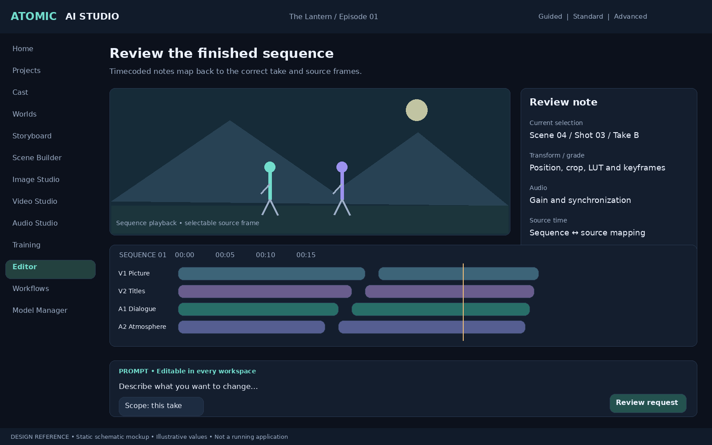

# v0.8 — Production Completion, Reliability and Release Scope

## Authority

Accepted amendment to v0.7. Read all preceding requirement files plus this document. These ten features extend existing modules; do not implement duplicate managers for budgets, QC, audio, recovery or commands. The three especially important improvements are **Automatic Backup and Crash Recovery**, **Smart Rendering Strategy**, and **AI Production Manager**—they are priorities within the ten, not three additional duplicate features.

This is a specification, not evidence of working software. All prior product requirements remain accepted, including multi-project isolation, multiple characters, direct prompt/world/hybrid creation, camera-follow modes, advanced editing and the Unified Creative Command System. Release staging below determines when a capability is delivered; it does not remove future scope.

## PM — AI Production Manager
Release priority: **Essential baseline; advanced planning after 1.0**.

Extend the existing production plan, health dashboard, scheduler and AI Director with an actionable next-step service. From target duration, script and available cast, estimate scene/shot counts, dependencies, generation workload, disk, local compute and cloud cost with ranges and assumptions. Identify blockers and recommend the next user task with an explanation and links. Distinguish story length from generated footage, rerolls and final edit duration. Plans update when the user changes scope; recommendations never approve themselves or automatically spend money. A deterministic rules-based next-step service must work offline even if the conversational assistant requires a separate model.

Acceptance evidence: Create a short-film plan, approve only one scene, complete its keyframe and verify the next recommendation changes. Explain a missing voice/reference blocker. Update estimates after a duration change without rewriting approved shots.

## REPAIR_LOOP — Automatic Scene Consistency Repair
Release priority: **Essential proposal/manual routing; advanced automation after 1.0**.

Connect Continuity Supervisor and existing region repair through detect → explain → suggest → approve → repair → verify. Each finding cites exact asset/version/frame range, uncertainty and evidence. Offer affected-shot regeneration, segment/region repair, reference-conditioned workflow or Keep intentionally. Preview mask, prompt, scope, supported controls and estimated cost. Execution creates a derived take; re-evaluate the same finding and surrounding frames/audio with evaluator versions pinned. Failed verification remains visible, not automatically accepted; bounded retries need an authorized policy.

Acceptance evidence: Seed a hair inconsistency, select a supported repair, approve and create a new version, compare before/after and record verification. Keep intentionally suppresses the specific reviewed issue without changing canon. Original remains available; no infinite retry loop.

## TRAILER — AI Movie Trailer Generator
Release priority: **Post-release enhancement**.

Build editable teaser/trailer timelines from approved footage by default. Offer 30-second, 60-second and 120-second targets plus custom duration; use scene labels, dialogue, story chronology, emotional beats, spoiler exclusions, source rights and user-selected highlights. Propose pacing, title cards, music/SFX cues and source ranges. Do not spend on new footage or music without explicit scope/budget authorization. Reuse the editor, sound director and publishing workflow; a trailer is a separate sequence linked to source versions.

Acceptance evidence: Produce a proposed 30-second teaser from approved clips with source ranges and spoiler exclusions; user revises selection and exports. Main film timeline remains unchanged; unavailable footage/music is flagged.

## POSTER — Movie Poster and Thumbnail Studio
Release priority: **Post-release enhancement**.

Extend image studio/style designer/publishing with promotional layouts using approved character identity, location/style references and user-editable prompts. Separate editable text layers, typography, logos, crop/safe areas and composited character placement from generated artwork; do not depend on image models for accurate lettering. Support posters, thumbnails, banners and title treatments with target-specific presets, licensing/provenance and font dependencies. New designs are project assets and do not redefine character canon.

Acceptance evidence: Create a thumbnail from two approved characters, change title text without regenerating the art, adjust framing, export at chosen dimensions and retain layered source and source-version links.

## STRATEGY — Smart Rendering Strategy
Release priority: **Essential baseline; expanded optimization after 1.0**.

Compare compatible workflows under Fastest, Balanced and Highest Quality intent presets. Use measured hardware/model profiles, current resource availability, cached outputs, resolution/duration constraints, disk headroom, quality-tier behavior and known cloud prices. Display actual proposed settings, measured evidence, uncertainty and tradeoffs. Highest Quality is an intent, never an objectively guaranteed ranking. Respect offline/local-only and budget policy; unavailable data is labeled unknown. User can inspect/edit the effective prompt/model/conditioning and choose another plan. Selection creates a versioned RenderStrategyPlan consumed by the existing command/job system.

Acceptance evidence: For a fixed shot compare two valid strategies; explain time/VRAM/cost differences. Reject insufficient disk and incompatible LoRAs. Local-only mode never selects cloud; choosing a strategy does not submit a job until the authorized Generate action.

## RECOVERY — Automatic Backup and Crash Recovery
Release priority: **Critical Version 1.0 release gate**.

Extend existing autosave, snapshots, backups and persistent jobs into a single recovery system. Configurable autosave interval and backup retention; transaction-consistent database snapshot paired with versioned asset/dependency manifest; temporary writes committed atomically and hash-verified. A same-disk snapshot is not disaster protection: offer a user-chosen second drive/location and explain unavailable destinations. Never delete the last verified good backup or media pinned by approved manifests/branches. Check database integrity at suitable points and after detected corruption; quarantine failed records and preserve recoverable originals. Recovery wizard previews last saved state, missing media, active jobs and options before restoring; checkpoint before a destructive restore. Jobs resume only where the backend supports checkpointing; otherwise retain inputs and offer restart. Reconcile uncertain remote submissions before retrying to avoid duplicate charges.

Acceptance evidence: Crash during autosave and during a segmented render, reopen and recover the latest complete state without corrupting the project. Restore an independently verified backup to a temporary location. Simulate full disk, corrupt backup, unavailable backup drive and unknown remote-job status; preserve last-good copy and completed assets. Prove other projects remain unchanged.

## COMPARE — Visual Before-and-After Comparison
Release priority: **Essential A/B and side-by-side; advanced analysis after 1.0**.

Extend take comparison into synchronized playback/scrubbing, side-by-side, split wipe, frame-difference and A/B switching. Persist comparison source versions and time mapping. Match color interpretation, scaling, frame rate and audio monitoring deliberately; flag different durations, retimes or resolutions. Frame differences show pixel change, not an aesthetic quality score. User can inspect masks/prompts/settings/QC and select a take without overwriting original footage.

Acceptance evidence: Compare original and repaired clips at matching source times; handle mismatched durations with visible alignment rather than drift. Toggle audio source to prevent double playback. Selected take updates through a validated command; other versions remain pinned as required.

## DUB — AI Localization and Dubbing Studio
Release priority: **Post-release enhancement; retain existing language/caption foundation**.

Create language-specific sequence versions while preserving the source master. Translate dialogue as reviewable drafts with character/speaker mapping, glossary, context, pronunciation and timing; permit original voice only with valid authorization. Generate new performances, review translation/pronunciation and optionally run supported lip-sync correction. New audio duration may require reviewed retiming or text adaptation, never silent picture changes. Reuse music/effects stems as appropriate; retain language-specific mixes/subtitles, credits/provenance and capability warnings.

Acceptance evidence: Create a French version from an English sequence; review translation, correct one pronunciation and regenerate only the affected line/dependencies. Preserve English master, speaker identity and original picture; flag unsupported voice language and mismatched timing.

## SHARE — Community Presets and Workflow Sharing
Release priority: **Post-release enhancement; schema validation foundation in 1.0**.

Start with import/export packages, not an online marketplace. Package camera presets, lighting/style settings, prompts, typed workflows and production templates with schema version, hashes, creator metadata, dependency/license report and compatibility declarations. Export excludes secrets/private references unless explicitly selected. Preflight before import; imported workflows cannot execute code, install dependencies or launch generation on arrival. Prevent path traversal, archive bombs and unbounded node/resource counts. Do not treat a checksum as proof of a trusted author. Import into explicit project/application scope with copy/version rules; show what will change.

Acceptance evidence: Round-trip a camera/prompt workflow package. Reject malicious paths, altered hashes and unsupported schema. Missing licensed dependencies produce an actionable report; import performs no paid calls or hidden script execution.

## REVIEW_FILM — Interactive Film Review Mode
Release priority: **Essential local review; expanded review tools after 1.0**.

Distraction-free player with frame-accurate pause, range selection, keyboard shortcuts, subtitles and comments linked to immutable sequence revision. Map sequence tick/timecode to actual source clip, shot, take and source frame using edit decision data including trims, speed changes, nested sequences and transitions. A dissolve may map to two clips: expose both. “At 12:34 make her more frightened” becomes a scoped note/proposed command, not immediate generation. Jump to the relevant edit/repair/performance control. After re-editing, comments retain original sequence reference and show mapped/stale state rather than silently attaching to a different frame.

Acceptance evidence: Leave a review comment on a retimed shot, navigate to its correct source range and propose an expression change. Re-edit timeline and retain original comment provenance; test transition ambiguity, fractional FPS and source-version changes.

## Beginner home screen — mandatory

Four primary actions: **Create a Movie**, **Create a Scene**, **Create an Image**, **Continue a Project**. Explain each in ordinary language. Create a Movie accepts an idea or screenplay and starts a reviewed plan; it does not promise one-click feature-film completion. Scene and Image support prompt-only work without building a bible. Continue shows project progress, pending recovery and the next recommended action. Voice/audio creation, editor and all advanced tools remain directly reachable through navigation and search, not removed because the home screen has four actions. Prompt editing is always accessible.

## Three highest-priority improvements

| Improvement | First implementation | Release proof |
|---|---|---|
| Backup and crash recovery | Phase 0 job/state durability; Phase 1 backup/restore | Crash/full-disk/corrupt-backup/restore tests and Windows recovery walkthrough |
| Smart rendering strategy | Phase 3 compatibility/estimates; Phase 4 selectable strategy | Tested local strategy, honest estimates, budget/offline enforcement and manual override |
| AI Production Manager | Phase 1 rules-based next steps; Phase 8 AI-assisted refinement | Novice follows reviewed plan to complete a short sequence; explainable blockers and progress |

## Version 1.0 essentials versus post-release enhancements

Version 1.0 is a stable first short-film production release, not a claim that the entire long-term professional studio is complete. Freeze its implementation backlog before work; additions to accepted future scope do not silently expand the active sprint. A release must explicitly list unsupported model/task combinations and cannot label placeholder panels as functional.

| Area | Version 1.0 essential scope | Later accepted enhancements |
|---|---|---|
| Foundation | Standalone Windows setup, multiple isolated projects/cast, commands, versions, persistent jobs, offline installed operation | Expanded plugin SDK, collaboration service, render farm |
| Beginner journey | Four-action home, guided setup, editable prompts, sample project, actionable errors, accessible key flow | Expanded interactive lessons and project templates |
| Production | Structured scenes/shots, world/character versions, next-step manager, budget/resource estimates | Advanced feature-length scheduling and autonomous plan optimization |
| Generation | Verified core local image/video/voice workflow, draft/final settings, effective-request inspector, honest capability controls | Additional model adapters, more advanced repair/multi-pass combinations |
| Camera | Existing ten-mode scene-preview requirement and editable camera prompts; disclose model adherence limitations | Additional verified camera-conditioning adapters |
| Editing and review | Stable multitrack core, trim/arrange/mix, source mapping, local comments, A/B comparison, validated export | Remaining professional editing operations, advanced difference analysis |
| Reliability | Verified backups, recovery wizard, project portability checks, immutable approved-shot records | Expanded automation policies and remote recovery targets |
| Promotional output | Existing basic export/publishing presets | Trailer generator and dedicated layered Poster/Thumbnail Studio |
| Localization/sharing | Existing language metadata, subtitle foundation, typed package validation | Full dubbing studio and community package exchange UI |
| Consistency | Findings, user review, manual routing to supported repair/generation | Expanded automatic detect-to-verified-repair workflows |

The staged editor is not yet a replacement for every professional editor function at 1.0; keep the full advanced-editor requirements in the later roadmap and describe shipped support accurately. Likewise, core verified adapters must be enumerated with exact tested tasks, model/runtime versions, supported Windows hardware and licenses in the implementation compatibility report. Any change to the frozen release definition goes through a visible plan revision.

## Data, commands and API additions

Extend existing project-scoped entities rather than adding competing state. Proposed records: ProductionRecommendation (reason/evidence/blockers/status), ProductionEstimateVersion, RenderStrategyPlan (candidate workflows/evidence/unknowns/policy), BackupPolicy, BackupSet (database snapshot/media manifest/integrity/state), RecoverySession, ConsistencyRepairPlan/Verification, TrailerSequencePlan, PromotionalLayoutVersion/TextLayer, ComparisonAlignment, LocalizationVersion, DubLineRevision, PresetPackage, FilmReviewComment/SequenceSourceBinding.

Command operations: propose/accept production plan; choose strategy; propose/approve repair; create trailer sequence; revise poster layers; verify/restore backup; set comparison/take selection; create localization version; preflight/import preset package; add review comment/propose targeted edit. Commands carry project/branch/entity IDs, expected revisions, idempotency key, authorization and cost scope. Generation-triggering commands remain distinct from previews. Restoring state or undoing edits never refunds consumed compute/API spending.

API service groups: production recommendations/estimates; strategy compare/resolve; repair propose/verify; trailers propose; promotional layouts revise/export; backups list/verify/restore; recovery reconcile; comparisons align; localization propose/review; preset packages preflight/import/export; film review annotate/map-to-source. Read/query services must respect project/branch isolation. Secrets are excluded from logs, backup packages, diagnostics and shared presets.

## Integrated implementation sequence

Phase 0: preserve Unified Creative Command System, persistent jobs, atomic state and recovery contracts. Phase 1: implement four-action home, next-step rules, backups/restore and review-note data. Phases 2–3: connect identity/world evidence and tested resource profiles. Phase 4: choose smart rendering strategies, baseline A/B comparisons and explicit consistency repair plans. Phases 5–7: maintain camera/performance requirements, source-time mappings, accessible review player, editing and exports. Phase 8: AI-assisted recommendations follow the same typed commands. Phase 9: clean-install, offline, recovery and novice validation gates. Deliver trailer/poster, full dubbing, community sharing and advanced automation in explicitly scheduled post-release increments.

## Release acceptance gates

1. Run the existing novice usability test and demonstrate a short film from idea through saved, playable export without terminal/Advanced Mode. Document real participants and interventions, not synthetic success claims.
2. Demonstrate three independent projects and multi-character isolation; existing character-volume acceptance criteria remain.
3. Exercise restart, full disk, missing media, corrupt backup, unavailable GPU and uncertain cloud-job status; prove preservation of last-good state and prevention of duplicate submissions.
4. Verify next-step advice and strategy choice can be explained, changed manually and used without silent cloud fallback.
5. Test fractional-FPS review mappings, retiming/transitions, synchronized comparison and completed export decode/AV integrity.
6. Validate migrations and backup restore against earlier supported schema versions. Run meaningful integration tests and real-model checks separately from mocked contracts.
7. Maintain a requirement traceability table linking accepted feature ID, release stage, implementation module, test evidence and known limitation. No feature is considered delivered merely because it appears in this handoff.

## v0.9 visual design references

See [Visual Design Specification](VISUAL_DESIGN_SPEC.md). These are new schematic design proposals, not working screenshots or recovered original photo cards.

### Create something extraordinary

A simple starting point. No technical setup required to explore.

### Compare takes

Synchronized A/B playback and source-time alignment.

### Your next production step

Actionable blockers, progress, budget and export readiness.

### Your work is safe • Recovery

Restore a verified version and reconcile interrupted jobs.

### Finish & export

Choose a destination, review validation and keep your master.

### Posters, thumbnails & trailers

Editable typography, approved footage and source references.

### Create another language version

Human-reviewed translation, voices, subtitles and lip-sync.

### Review the finished sequence

Timecoded notes map back to the correct take and source frames.

