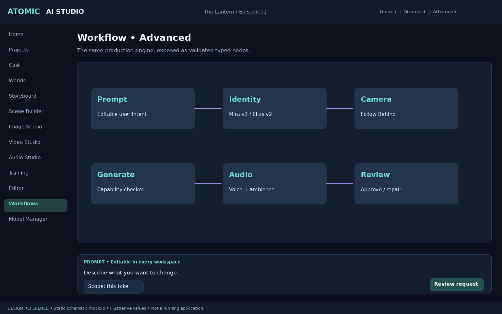
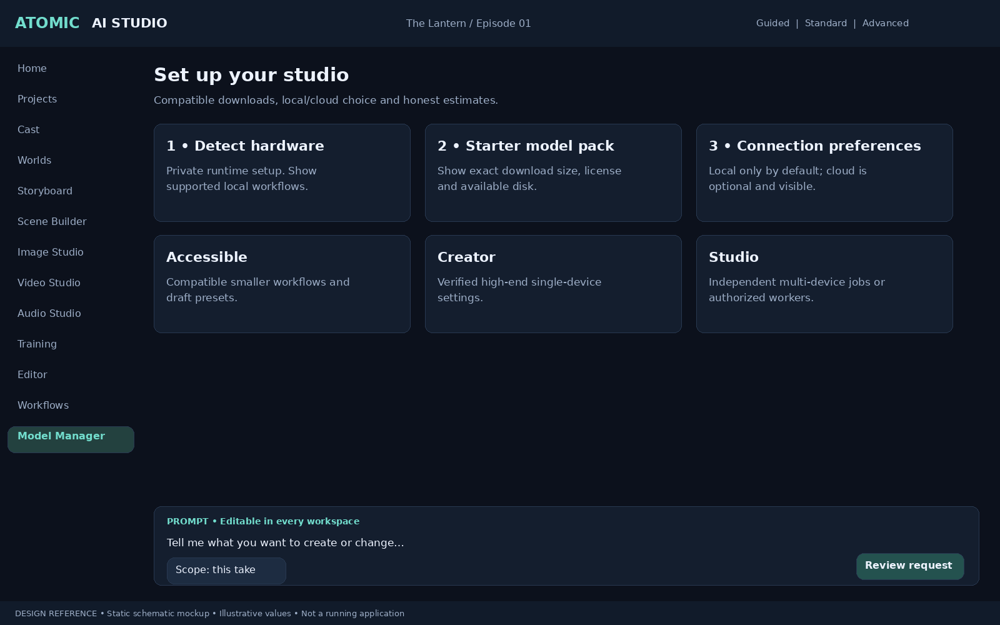

# v0.6 — Workflow Flexibility, Film Memory and Beginner Experience

## Authority and reading order

Read DEVELOPMENT_PLAN.md, ADDITIONAL_REQUIREMENTS.md, CINEMATIC_WORLD_AND_PROMPTS.md, then this amendment. v0.6 clarifies overlapping features and extends the same five-system architecture; do not build competing workflow, memory, catalog or portability services. All previous requirements and pictures remain included. Both direct prompts and persistent-world production remain first-class. Every AI operation must be inspectable, manually editable and reversible in project state; already consumed compute/API spending cannot be reversed.

## Ten accepted additions

### NODE — Node-Based Workflow Editor
Priority/delivery: Architectural priority; contracts Phase 0, UI Phases 4/7.

Simple controls and an advanced typed-node editor are views of the same versioned workflow definition. Nodes cover prompts, references, identity, LoRAs, camera, generation, enhancement and audio. Validate ports, schemas, cycles, capabilities and resources before running. Preserve prompts in either mode. Simple-to-advanced conversion is lossless for supported templates; arbitrary graphs that cannot map back become read-only in Simple Mode with explanation, never silently flattened. Imported graphs are data, not executable scripts. Extend the existing workflow engine.

Acceptance: Round-trip a supported workflow without parameter loss; retain an unsupported custom graph unchanged when switching views; reject cycles and incompatible ports.

### MEM — AI Film Memory Engine
Priority/delivery: Architectural priority; Phases 1/2/8.

Structured project-scoped facts cite exact approved scene/shot/asset versions, evidence, narrative-time validity, confidence, author and supersession. Distinguish story chronology from edit order. AI inferences remain proposals until confirmed; contradictions are surfaced, not silently resolved. Users inspect, correct, retire or override facts. Retrieval respects active creative branch and point in story time. An embedding index is a rebuildable search aid, not authoritative memory.

Acceptance: Record a left-arm injury valid from Scene 4 until a healing event; retrieve it for Scene 19, preserve corrections and do not apply an alternate-branch event to the main story.

### FILM — Story-to-Film Automation
Priority/delivery: Architectural priority; plan Phase 1, execution Phases 4/8.

Import screenplay text and supported screenplay files via validated import adapters. Preview parsed scenes, characters, dialogue and ambiguous assignments. Create an editable production plan, memory links, cast, locations, shots, keyframes, performance and audio cues, estimates and rough-cut proposal. Execute approved scopes through the existing persistent DAG with budget limits, checkpoints, partial retry and manual intervention. Long films are composed of reviewable sequences; one-click reliable feature-film completion is not promised.

Acceptance: Import a multi-scene script, correct a duplicate character match, approve one sequence and run it without launching unapproved sequences; resume after restart without duplicate paid requests.

### EXTEND — Video Extension and Shot Stitching
Priority/delivery: High; Phase 4 foundation, advanced Phases 7/9.

Capability-gated extend-before/after jobs use selected boundary frames, audio, motion, identities and world references. Generate alternative continuations as child takes; inspect overlap, timing, AV continuity and seam artifacts. Store trimming, crossfades, interpolation and retiming as explicit edit operations. If native extension is unavailable, offer a labeled conditioned adjacent-shot workflow or manual edit; seamless output is never guaranteed.

Acceptance: Create two alternative continuations, compare joins, select one and preserve the source clip and audio alignment; reject unsupported native-extension settings.

### PREVIEW — Draft, Preview and Final Quality Tiers
Priority/delivery: High; Phases 3/4/7.

Named presets translate to supported provider settings with visible estimated time/cost. Draft generation differs from editing proxies: proxy files are derivatives of existing footage. Do not imply low-resolution output can always be rerun at final quality with identical motion or identity. Final generation creates a new take; users approve differences. Proxy relinking uses asset identity and timebase, not filename alone. Prefer responsive progressive preview labels over promises of real-time model inference.

Acceptance: Switch tiers and show actual changed settings; relink an editing proxy to its original; retain draft footage after a final regeneration that changes motion.

### CATALOG — Model Catalog and Compatibility Registry
Priority/delivery: High; Phases 3/9.

Extend existing model manager/lab with a curated catalog of installed and available models, tasks, licenses, source revisions, dependencies, hardware profiles, storage, download size and capability evidence. Label verified configuration versus experimental/community integration, with verification date and exact configuration. Checksummed/resumable installation, license acceptance, rollback and offline installed catalog. Do not execute arbitrary community install scripts. Commercial transactions are outside initial scope.

Acceptance: Install a tested package, block a checksum mismatch, label an unverified adapter experimental and keep installed local models usable offline.

### PORT — Automatic Project Portability
Priority/delivery: High; Phases 1/9.

Extend existing dependency manager: preflight before export, transfer or archive restoration. List missing/incompatible models, LoRAs, media, fonts, plugins, LUTs, workflow versions and nonredistributable components; offer explicit relink/download guidance and exclusion choices. Portable export includes pinned manifests and integrity checks, excludes secrets and caches by default, and reports external hosted dependencies that cannot be recreated locally.

Acceptance: Transfer a project package, identify a missing font and restricted weights, restore permitted assets and preserve historical provenance without silently substituting dependencies.

### BRANCH — Non-Destructive Creative Branching
Priority/delivery: High; contracts Phase 0, UI Phases 1/7.

Branches fork immutable scene/project revision references and retain shared media by content identity. Alternate prompts, world facts, performance, takes and timeline revisions remain branch-scoped. Compare, cherry-pick or explicitly merge revisions with conflict resolution; approvals point to exact branch/revision/manifests. Undo cannot undo remote spending; reverting selects earlier state while preserving externally created outputs and audit history. Garbage collection respects every branch and approved manifest.

Acceptance: Fork approved Scene 12, change lighting and dialogue, compare versions, revert and retain the original; detect a conflicting world-fact merge and preserve pinned assets.

### HEALTH — Project Health Dashboard
Priority/delivery: High; Phases 1/4/9.

Aggregate shot progress, continuity/QC findings, missing dependencies, reference completeness, resource use, budget, pending approvals and export readiness. Each issue links to a corrective action. Show last computation time and invalidate stale summaries. Estimated remaining work has uncertainty; no universal green score overrides unresolved hard delivery checks. Project and branch scope are always visible.

Acceptance: Introduce a missing asset and pending approval, navigate to both from the dashboard and clear them; refresh stale counts after switching projects/branches.

### MIGRATE — AI Model Fallback and Migration
Priority/delivery: High; Phases 4/8/9.

Capability-aware migration maps supported settings between exact provider/model versions and produces an inspectable loss/conversion report. Create a new take/branch; preserve original approved shots and requests. Never silently substitute a failed provider, send local data to cloud or exceed authorization/budget. User can preauthorize bounded fallback policies; each execution logs the selected model and mappings. Model changes invalidate affected cached generation results.

Acceptance: Migrate a shot with unsupported last-frame control and see the warning before submission; new take preserves source settings; local-only policy blocks cloud fallback.

## BEGINNER — Primary experience for users with no AI-tool knowledge (Critical)

The default audience has no knowledge of ComfyUI, model architectures, LoRAs, VRAM, training commands, nodes or codecs. A new user must complete a small production without a terminal, external tool UI or technical tutorial. Backend implementation names belong in optional details, not required creative decisions.

### Workspace and vocabulary
- Default **Guided Studio** presents: Start a project → Add your cast → Describe a scene → Review storyboard → Create takes → Edit → Export. Advanced Mode remains available through progressive disclosure; switching never loses work.
- Show creative tasks such as “Create a picture,” “Make a video,” “Create a voice,” “Keep this character consistent,” “Fix part of a clip,” and “Export my movie.” Explain technical terms on demand. “Character training (LoRA)” may appear in advanced details, with status and purpose visible in plain language.
- Prompt box is always easy to find. Structured setup is optional for a quick experiment. Support freeform text plus optional editable fields for cast, mood, movement, camera, dialogue and sound. Provide sample prompts and examples of resulting settings; avoid requiring professional filmmaking vocabulary.
- Three workspace depths: Guided, Standard, Advanced. Node editing is optional; beginner users never need to inspect a graph or choose a sampler. Do not conceal actual model selection/provenance from users who want it.

### Guided setup and automatic recommendations
- Detect hardware/storage and offer a tested starter configuration, with estimated download size/time and required free disk space. Explain unavailable capabilities and offer supported alternatives. Do not install every model by default.
- The application manages its private runtimes, downloads and background processes. Users may still need to update a GPU driver; provide clear instructions and diagnostics. Never claim every dependency can be silently installed or redistributed.
- For each task recommend a verified engine using hardware, offline preference, expected speed/quality and cost. Explain the recommendation briefly, show estimated uncertainty and allow manual choice. Local mode must never silently switch to a paid/cloud provider.
- Cloud account/API setup uses a wizard with connection test, masked credentials and plain-language pricing explanations. Clarify that a consumer chat subscription does not establish API entitlement; verify provider-specific requirements during implementation. No account connection is required for supported installed local tasks.

### Safe creative progress
- Offer a short sample project and a guided 10–15 second first-film exercise; duration is a creative target, not a generation-time promise. Every step has skip/back/help and saved progress.
- Show one clear next action, labeled preview/take states and simple comparisons: Keep, Try another, Change prompt, Fix this area. Explain what is being regenerated and what remains selected.
- Training is optional and guided: explain why it may help, request useful angles/expressions with examples, show dataset quality issues, estimate resources and use tested presets. Character consistency is best effort, never guaranteed. No forced training for a first picture/video.
- Before a costly request show expected cost/time/storage, local versus cloud and scope. Reuse bounded authorization and budget rules; do not repeatedly ask approval for the same authorized operation.
- AI scene changes produce an editable proposal with “Apply to this take” as default and explicit broader scopes. Undo/redo and creative branches preserve user confidence. Show that cancelling cannot refund already incurred compute costs.

### Help, errors and accessibility
- Progress names stages (Preparing, Creating, Adding sound, Saving), explains long loading, and gives cancel/retry. Only show calibrated progress; do not invent precise completion percentages or deadlines.
- Errors state what happened, what work is safe, and a concrete action such as use a smaller preset, free storage or retry connection. Put raw logs in optional technical details; copyable diagnostics redact secrets and private references by default.
- Contextual help, searchable glossary, keyboard operation, accessible labels/focus, scalable text, sufficient contrast, captioned tutorials and reduced-motion preference are required. Color is never the only status signal.
- Export wizard asks destination/use (web, social, custom) and recommends a versioned preset; advanced codec/color/audio controls remain optional. Preview framing and subtitle crop before export.

### Beginner acceptance gates
1. Run a moderated usability test with at least five participants unfamiliar with AI tools. Define tasks and record interventions, completion, time and confusion; do not claim completion without actual sessions.
2. Target at least four of five completing the sample flow through playable export without opening a terminal or Advanced Mode. Report failures and iterate; the tiny sample is a design gate, not a population-wide success claim.
3. A novice can find the prompt, revise a take, retain the original, identify local/cloud execution and see cost before generation.
4. Low disk, missing GPU capacity, disconnected cloud and failed model download have understandable recovery paths; completed work survives restart.
5. Complete the primary flow by keyboard and check screen-reader labels/focus with the selected accessibility test tooling; document manual findings.
6. Automated UI tests cover guided setup, scope defaults and mode switching; real usability results are separate from automated or model-simulated tests.

## Schema, API and UI extensions

Project-scoped entities: FilmFactVersion, FactEvidence, NarrativeValidity, ScreenplayImport, ScreenplayRevision, ParseDecision, ProductionPlanVersion, PlanApproval, ExtensionRequest, ContinuationLink, QualityTierPreset, ProxyBinding, CreativeBranch, BranchRevision, MergeProposal, HealthReport, ModelMigrationPlan and SettingMapping. Application-scoped catalog records have source/version/configuration evidence; project jobs resolve and snapshot chosen records. Extend existing WorkflowDefinitionVersion instead of adding a parallel graph model. Facts cite immutable source versions; branch context and narrative position are mandatory for memory retrieval.

Service groups: workflow visual/schema validation and supported simple-view projection; facts retrieve/propose/correct; screenplays import/parse/reconcile; production plans preview/approve/execute; video extend/stitch; quality tiers resolve; catalog compatibility/verify/install; portability preflight; branches fork/diff/merge; health refresh; migration preview/approve. All preview/parse/plan actions disclose any AI call and respect authorization; a metadata preview must not unexpectedly start paid inference.

Guided UI is built from the same typed services and job snapshots as Advanced Mode. First-use progress, help preferences and accessibility settings are separate from creative canon. Do not store API keys in onboarding progress or exported diagnostics.

## Consolidated priorities and release sequence

| Phase | v0.6 scope | Gate |
|---|---|---|
| 0 | Shared graph contracts; branch/memory interfaces; Guided/Standard/Advanced shell | Mode changes preserve drafts, no hidden generation |
| 1 | Script import preview, memory facts, branch basics, dashboard and sample project | Project/branch isolation, import corrections, novice walkthrough |
| 2 | Cast-memory evidence and novice reference/consistency wizard | Multiple independent cast members and correct fact scope |
| 3 | Image prompts, quality presets and guided model recommendations | Prompt-only flow without technical configuration |
| 4 | Node editor first slice, extension, execution tiers, migration previews | Typed graph validation and capability-safe new takes |
| 5–7 | Blocking/audio guidance, proxies, stitching and export wizard | Retain originals, correct sync, accessible editing/export |
| 8 | Story-to-film orchestration and narrative memory retrieval | Approved sequence only; recovery and budgets |
| 9 | Catalog/portability/health hardening and novice usability gate | Clean Windows setup, offline path, recoverable errors |
| Later | Expanded arbitrary-node tooling and feature-length automation refinement | Verified workflow/backend support and measured production benchmarks |

The node system, memory engine and story-to-film orchestration are architectural priorities, not reasons to delay the first usable release until all advanced features exist. Freeze accepted scope for each milestone. The novice experience is a release requirement throughout, not a cosmetic layer added at the end. Maintain automated functional tests, schema migration tests, failure/recovery tests and human usability evidence.

## v0.9 visual design references

See [Visual Design Specification](VISUAL_DESIGN_SPEC.md). These are new schematic design proposals, not working screenshots or recovered original photo cards.

### Workflow • Advanced

The same production engine, exposed as validated typed nodes.

### Set up your studio

Compatible downloads, local/cloud choice and honest estimates.

